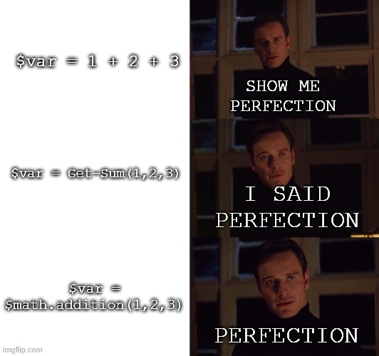
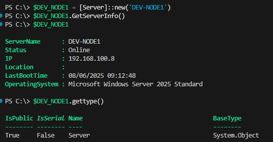
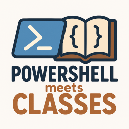

## Intro

I’ve always used PowerShell following the same pattern, that’s roughly how my learning path followed the PowerShell Best Practices.

- Quick and Dirty one-liners in the console, nowadays Terminal
- Gradually, those one-liners evolved into PowerShell scripts with better organized one-liners
- Variables came along, then functions, reusability increased
- Functions became modules, persistent data storage in JSON and technologically that was the end for a while
- The last highlight was threading and runspaces

I’ve been operating on these last two levels for quite a long time now, of course getting more efficient and generally my PowerShell knowledge became broader.

During this development, however, I noticed a problem: I’m a very organized person, at least in my professional environment 😉, and so should my code be, structured. I don’t think much of Clean Code, comments are just important at certain points, for me, for others, for my customers. Besides comments, structure is also important – what good do comments do me in a ‚bucket of chars‘? I also love symmetrical code, yeah go ahead and laugh, but it immediately makes clear what’s a variable, what’s an assignment and what’s the value. When I see something like this…

```powershell
$userInfo = @{
   Name = $varSurename
   Address = $varStreet
   Data = $varRandomLongVar
}

$configSettings = @{
   ServerName = 'localhost'
   Port = 5432
   Database = 'mydb'
   Timeout = 30
}

$employee = @{
   Personal = @{
       FirstName = $varSurename
       LastName = 'Doe'
       Street = $varStreet
   }
   Work = @{
       Department = 'IT'
       Position = 'Developer'
   }
}
```


… my insides turn outward 🤣 Maybe it’s also a disease. This is a normal writing style that’s considered clean, I know, but it should look like this …

```powershell
$userInfo = @{
   Name 	= $varSurename
   Address 	= $varStreet
   Data 	= $varRandomLongVar
}

$configSettings = @{
   ServerName 	= 'localhost'
   Port 		= 5432
   Database 	= 'mydb'
   Timeout 		= 30
}

$employee = @{
   Personal = @{
       FirstName 	= $varSurename
       LastName 	= 'Doe'
       Street 		= $varStreet
   }
   Work 	= @{
       Department 	= 'IT'
       Position 	= 'Developer'
   }
}

$users = @(
   @{ Name = 'Alice'; 		Role = 'Admin' }
   @{ Name = $varSurename; 	Role = 'User' }
)
```


Anyway, that’s not what this is about. It’s basically the case that structure and order gradually decrease in larger projects and classes play exactly into this topic. But why only now? Classes have existed since PowerShell 5.0.

## AI Assisted Coding

Of course I was an early adopter of all the AI chatbots and was amazed at what ChatGPT could already do 2 years ago. Of course the code, regardless of language, was unusable, but definitely useful for knowledge generation. As the quality progressed, the code got better and the solution approaches became more and more interesting.

At some point, classes started appearing in the suggestions and I consistently ignored them 😝. Through my C# journeys, I knew that classes are simply the standard, but you should fundamentally know what you want to do with them in the project to design them cleanly. And I didn’t want to make that effort.

## The New Project

It was time to adapt a 4-year-old solution to new requirements, as is sometimes the case. Since my knowledge doesn’t stand still either, after briefly skimming through the code, I decided:

**I’M NOT TOUCHING THIS ANYMORE**, **THIS ALL HAS TO BE NEW!!**

Now I was in the relaxed position that everything was available for the solution:

- Program flow chart
- Function descriptions
- Programmatic solution of the required functions at the lowest level
- 4 years of lessons learned

So I only had to worry about orchestrating all the steps and decided to give classes a chance. In theory, this is namely the cleanest and most structured way to code.

The result hasn’t completely changed my way of coding, but it has sustainably changed it – but more on that later.

## Conclusion After 5 Weeks in the Project {#powershell-classes-conclusion}

Classes in PowerShell are so incredibly simple, so structured, so beautiful❤️. Of course the use case has to fit, since the implementation initially requires more structure, but when that’s given, there will be no way around classes for me anymore.



## Why This Article, Aren’t There Enough Already?

There are some articles about classes in PowerShell and object orientation, but still this topic is hardly covered in a classic tutorial. It’s always the functions and you have to know about this topic to find it. So I’m simply writing another article, also in german this time, to maybe reach one or the other additionally, because…


---

## Background Info on PowerShell Classes – OOP Since Version 5.0

Classes have existed in PowerShell since PowerShell 5.0, so 2016… and I only learned about them a year ago 🤦‍♂️. PowerShell classes bring object-oriented programming concepts to PowerShell and thus also have all the basic features of a class.

- **Properties**: Properties are strongly typed and support most validation attributes like \[ValidateNotNull()\], \[ValidateRange()\], etc.
- **Methods**: Methods are functions bound to an object and must explicitly define the return type
- **Constructors**: Enable initialization of objects with specific values
- **Inheritance**: Allows creating new classes from existing classes and extending their functionality

A class, after loading, is its own data type – more on that later.

---

## And How Does This Work Now?

I still remember how I struggled with OOP many years ago and it’s generally assumed that rather admins than full-blood software developers initially deal with PowerShell. So I’ll try to keep it totally simple.


I’ll take a fictional module that queries server properties via remoting and evaluates them locally, a classic admin task.

**ATTENTION:** Of course this example is very constructed and not necessarily practical, but in my opinion it shows the relationships quite well.

This PowerShell classes tutorial shows you the most important concepts for object-oriented programming with PowerShell.

### Properties

A class has a firmly defined set of properties at all times. This cannot be changed at runtime, but must be described in the definition of the class.

### The Class

```powershell
class Server {
# All Possible properties for the Server class
    [string]        $ServerName
    [string]        $Status
    [ipaddress]     $IP
    [string]        $Location
    [datetime]      $LastBootTime
    [string]        $OperatingSystem
# -------------------------------------------
}
```

### Constructors

A constructor creates the instance of a class. The class can receive default values, or the constructor expects parameters. In our case, a server name makes sense. So I give the property **ServerName** a value directly when loading.

```powershell
class Server {
# All Possible properties for the Server class
    [string]        $ServerName
    [string]        $Status
    [ipaddress]     $IP
    [string]        $Location
    [datetime]      $LastBootTime
    [string]        $OperatingSystem
# -------------------------------------------

    # Constructor
    Server([string]$name) {
        $this.ServerName = $name
    }
}
```

Now we have a class, but how do we get a server in there? By loading the class into a variable and preferably also dynamically for all servers.

```powershell
class Server {
# All Possible properties for the Server class
    [string]        $ServerName
    [string]        $Status
    [ipaddress]     $IP
    [string]        $Location
    [datetime]      $LastBootTime
    [string]        $OperatingSystem
# -------------------------------------------

    # Constructor
    Server([string]$name) {
        $this.ServerName = $name
    }
}

$serverlist = @('Server1','Server2','Server3')

foreach ( $server in $serverlist ) {

    # Create a new Server object for each server name
    New-Variable -Name "obj_$server" -Value ([Server]::new($server)) -Force

}
```

### Methods

Methods make classes really interesting in my opinion. Methods are the functions with which I can manipulate properties of classes or generate RETURNS based on arguments that I add to the call. Here I already specify the type of return in the method definition. **VOID** thus logically creates no return.

```powershell
class Server {
    [string]        $ServerName
    [string]        $Status
    [ipaddress]     $IP
    [string]        $Location
    [datetime]      $LastBootTime
    [string]        $OperatingSystem

    Server([string]$name) {
        $this.ServerName = $name
    }

    [void] GetServerInfo() {

        try {

            $osInfo = Invoke-Command -ComputerName $this.ServerName -ScriptBlock {
                Get-CimInstance Win32_OperatingSystem | Select-Object Caption, LastBootUpTime
            } -ErrorAction Stop

            $this.IP = Invoke-Command -ComputerName $this.ServerName -ScriptBlock {
                (Get-NetIPAddress -AddressFamily IPv4 | Where-Object {$_.IPAddress -notlike '169.*'} | Select-Object -First 1).IPAddress
            } -ErrorAction Stop

            $this.OperatingSystem = $osInfo.Caption
            $this.LastBootTime    = $osInfo.LastBootUpTime
            $this.Status          = "Online"

        } catch {

            $this.Status = "Offline"

        }
    }
}

$serverlist = @('Server1','Server2','Server3')

foreach ($server in $serverlist) {
    New-Variable -Name "obj_$server" -Value ([Server]::new($server)) -Force
}

$obj_Server1.GetServerInfo()
$obj_Server2.GetServerInfo()
$obj_Server3.GetServerInfo()
```

Here I’ve inserted the method **GetServerInfo()**, which now collects the information about the server. I don’t need to pass an argument or start a cmdlet, since the instance (server name) of the class (Server) has inherited everything. I don’t need external functions, variables or anything else, everything is available in the class. ❤️ Following an example from the LAB:



*LAB Results*

## And Now, Where’s the Benefit?

Of course this isn’t the most optimal use case, but it’s understandable. One possibility would be to create a logging class. Here from my project:

```powershell
class PatchLogger {
     [string]        $ServerName
     [string]        $LogPathServer
     [string]        $LogLevel = 'INFO'
     [hashtable]     $LogTargets
     [bool]          $ConsoleOutput
     [bool]          $StreamOutput
     [string]        $VerbosePreference
     [string]        $DebugPreference

     # Constructor
     PatchLogger(	[string]$LogPathServer,
					[string]$ServerName,
					[string]$MessageFile,
					[string]$ErrorFile,
					[string]$VerboseFile,
					[string]$DebugFile,
					[string]$SqlServerFile,
					[bool]$ConsoleOutput 	= $true,
					[bool]$StreamOutput 	= $false) {

          $this.LogPathServer   = $LogPathServer
          $this.ServerName      = $ServerName
          $this.ConsoleOutput   = $ConsoleOutput
          $this.StreamOutput    = $StreamOutput
          $this.LogTargets      = @{
               Main           = $MessageFile
               Error          = $ErrorFile
               Verbose        = $VerboseFile
               Debug          = $DebugFile
               SqlServer      = $SqlServerFile
          }

          $this.VerbosePreference = $Global:VerbosePreference
          $this.DebugPreference   = $Global:DebugPreference

          if ( -not (Test-Path $this.LogPathServer) ) {
               New-Item -Path $this.LogPathServer -ItemType Directory -Force | Out-Null
          }
    }

}
```

An instance of the class is loaded directly into the variable **$PatchLogger** when the module loads, and from now on I can start right away with **$PatchLogger.Info($message)**. How? Such a short command with such a complex class? Let’s get to the last thing, which in my opinion is the advantage par excellence: **Overloading**.

## Overloading

Overloading means nothing other than the number of arguments I pass to a method. Based on the number, the engine can distinguish which method is used, since I can have several with the same name. The technical term would be Method Overloading.

The added value lies in the fact that I don’t have to work with BoundParams, Switch or IF loops like with functions. When a helper method is called with only one argument, the missing arguments are filled in internally and the main method is called.

Let’s take the example **$PatchLogger.Info($message)**

```powershell
# Hauptmethode
[hashtable] WriteLog([string]$Level, [string]$Message, [string]$MessageCode, [int]$Severity, [string]$Target, [bool]$ReturnObject) {...}

# Helfermethode
[hashtable] Info([string]$Message) {
      return $this.WriteLog('INFO', $Message, $null, 0, 'Main', $true)
}

# Helfermethode 2
[hashtable] Info([string]$Message, [string]$MessageCode) {
      return $this.WriteLog('INFO', $Message, $MessageCode, 0, 'Main', $true)
}
```

What will be most needed in a large module? A simple message to the main log, without message code and frills. So the helper method calls the main method with the default values that do exactly that.

Let’s look at helper method 2. This expects 2 arguments, namely a MessageCode. Now I can write a registered message with **$PatchLogger.Info(„Process XY completed“,“I0002″)**.

Of course I can also implement all this with functions, but I don’t think it’s as structured and pretty.



```powershell
class PatchLogger {
     [string]        $ServerName
     [string]        $LogPathServer
     [string]        $LogLevel = 'INFO'
     [hashtable]     $LogTargets
     [bool]          $ConsoleOutput
     [bool]          $StreamOutput
     [string]        $VerbosePreference
     [string]        $DebugPreference

     # Constructor
     PatchLogger([string]$LogPathServer, [string]$ServerName, [string]$MessageFile, [string]$ErrorFile, [string]$VerboseFile, [string]$DebugFile, [string]$SqlServerFile, [bool]$ConsoleOutput = $true, [bool]$StreamOutput = $false) {
          $this.LogPathServer   = $LogPathServer
          $this.ServerName      = $ServerName
          $this.ConsoleOutput   = $ConsoleOutput
          $this.StreamOutput    = $StreamOutput
          $this.LogTargets      = @{
               Main           = $MessageFile
               Error          = $ErrorFile
               Verbose        = $VerboseFile
               Debug          = $DebugFile
               SqlServer      = $SqlServerFile
          }

          $this.VerbosePreference = $Global:VerbosePreference
          $this.DebugPreference   = $Global:DebugPreference

          if ( -not (Test-Path $this.LogPathServer) ) {
               New-Item -Path $this.LogPathServer -ItemType Directory -Force | Out-Null
          }
     }

     [void] UpdatePreferences([string]$VerbosePreference, [string]$DebugPreference) {
          $this.VerbosePreference = $VerbosePreference
          $this.DebugPreference   = $DebugPreference
     }

     # Central WriteLog method - all other methods call this one
     [object] WriteLog([string]$Level, [string]$Message, [string]$MessageCode, [int]$Severity, [string]$Target, [bool]$ReturnObject) {

          $timestamp          = Get-Date -Format "yyyy-MM-dd HH:mm:ss"
          $severityText       = if ($Severity -ne 9999) { "S$Severity" } else { "" }
          $messageCodeText    = if ($MessageCode) { " $MessageCode" } else { "" }

          $paddedLevel        = "{0,-9}" -f "[$Level]"

          $additionalInfo     = "$severityText$messageCodeText"
          $logEntry           = if ( $level -eq 'BLANK' ) {
                                   ""
                                } elseif ( $Level -notin @('VERBOSE','DEBUG') -and -not [string]::IsNullOrEmpty($additionalInfo) ) {
                                   "[$timestamp] $paddedLevel [$($this.ServerName)] $Message ($additionalInfo)"
                                } else {
                                   "[$timestamp] $paddedLevel [$($this.ServerName)] $Message"
                              }

          $targetFile = $this.LogTargets[$Target]
          if ( $targetFile ) {
               try {
                    Add-Content -Path $targetFile -Value $logEntry -Encoding UTF8

                    $verboseFile = $this.LogTargets['Verbose']
                    if ( $verboseFile -and $Level -ne 'VERBOSE' ) {
                         Add-Content -Path $verboseFile -Value $logEntry -Encoding UTF8 # for unbroken verbose stream
                    }

               } catch {
                    Invoke-ScriptError $_
               }
          }

          if ( $this.ConsoleOutput ) {
               switch ( $Level ) {
                    'ERROR'        { Write-Host $logEntry -ForegroundColor Red }
                    'WARNING'      { Write-Host $logEntry -ForegroundColor Yellow }
                    'INFO'         { Write-Host $logEntry -ForegroundColor Green }
                    'BLANK'        { Write-Host $logEntry}
                    'VERBOSE'      {
                         if ( $this.VerbosePreference -ne 'SilentlyContinue' ) {
                              Write-Host $logEntry -ForegroundColor Cyan
                         }
                    }
                    'DEBUG'        {
                         if ( $this.DebugPreference -ne 'SilentlyContinue' ) {
                              Write-Host $logEntry -ForegroundColor Magenta
                         }
                    }
               }
          }

          # PowerShell streams for integration - only if explicitly enabled
          if ( $this.StreamOutput ) {
               switch ($Level) {
                    'ERROR'   { Write-Error       $Message -ErrorAction Continue }
                    'WARNING' { Write-Warning     $Message }
                    'VERBOSE' { Write-Verbose     $Message }
                    'DEBUG'   { Write-Debug       $Message }
               }
          }

          # Return object only when requested
          if ( $ReturnObject ) {
               return @{
                    HasError    = $Level -eq 'ERROR'
                    HasWarning  = $Level -eq 'WARNING'
                    MessageCode = if ( $MessageCode ) { $MessageCode } else { $null }
                    Message     = $Message
                    Severity    = $Severity
                    Level       = $Level
                    Target      = $Target
               }
          }

          return $null
     }

     # BLANK Line
     [void] BlankLine() {
          $this.WriteLog('BLANK', '', $null, 0, 'Main', $false)
     }

     # INFO Methods - standard return hashtable
     [hashtable] Info([string]$Message) {
          return $this.WriteLog('INFO', $Message, $null, 0, 'Main', $true)
     }

     [hashtable] Info([string]$Message, [string]$MessageCode) {
          return $this.WriteLog('INFO', $Message, $MessageCode, 0, 'Main', $true)
     }

     # INFO NoReturn
     [void] InfoNoReturn([string]$Message) {
          $this.WriteLog('INFO', $Message, $null, 0, 'Main', $false)
     }

     [void] InfoNoReturn([string]$Message, [string]$MessageCode) {
          $this.WriteLog('INFO', $Message, $MessageCode, 0, 'Main', $false)
     }

     # WARNING Methods - standard return hashtable
     [hashtable] Warning([string]$Message) {
          return $this.WriteLog('WARNING', $Message, $null, 1, 'Main', $true)
     }

     [hashtable] Warning([string]$Message, [string]$MessageCode) {
          return $this.WriteLog('WARNING', $Message, $MessageCode, 1, 'Main', $true)
     }

     # WARNING NoReturn
     [void] WarningNoReturn([string]$Message) {
          $this.WriteLog('WARNING', $Message, $null, 1, 'Main', $false)
     }

     [void] WarningNoReturn([string]$Message, [string]$MessageCode) {
          $this.WriteLog('WARNING', $Message, $MessageCode, 1, 'Main', $false)
     }

     # ERROR Methods - standard return hashtable
     [hashtable] Error([string]$Message) {
          return $this.WriteLog('ERROR', $Message, $null, 2, 'Error', $true)
     }

     [hashtable] Error([string]$Message, [string]$MessageCode) {
          return $this.WriteLog('ERROR', $Message, $MessageCode, 2, 'Error', $true)
     }

     # ERROR NoReturn
     [void] ErrorNoReturn([string]$Message) {
          $this.WriteLog('ERROR', $Message, $null, 2, 'Error', $false)
     }

     [void] ErrorNoReturn([string]$Message, [string]$MessageCode) {
          $this.WriteLog('ERROR', $Message, $MessageCode, 2, 'Error', $false)
     }

     # VERBOSE & DEBUG - NoReturn
     [void] Verbose([string]$Message) {
          $this.WriteLog('VERBOSE', $Message, $null, 0, 'Verbose', $false)
     }

     [void] Debug([string]$Message) {
          $this.WriteLog('DEBUG', $Message, $null, 0, 'Debug', $false)
     }

     # Step/SQL/AG Methods - NoReturn
     [void] StepStart([int]$Step, [string]$StepName) {
          $this.BlankLine()
          $message = "========================= STEP $Step START: $StepName ========================="
          $this.WriteLog('INFO', $message, $null, 9999, 'Main', $false)
     }

     [void] StepEnd([int]$Step, [string]$StepName, [bool]$Success) {
          $status   = if ( $Success ) { "SUCCESS" } else { "FAILED" }
          $message  = "========================= STEP $Step END: $StepName - $status ========================="
          $this.WriteLog('INFO', $message, $null, 9999, 'Main', $false)
          $this.BlankLine()
     }

}
```



## Summary

PowerShell classes revolutionize how you structure larger projects. Available since PowerShell 5.0, they offer object-oriented programming with properties, methods, constructors, and method overloading. The initial extra effort pays off through clean, maintainable code – especially for modules and more complex function collections.

**The most important advantages at a glance:**

- Strongly typed properties with validation
- Encapsulated functionality through methods
- Elegant overloading instead of complex parameter logic and a structure that remains understandable even after months

For daily-doing scripts, the classic approach remains more practical, but as soon as reusability and structure become important, there’s no way around classes for me anymore. 🫡


