# Intro

[psTerminalPerfCounter](https://github.com/gabrielkoehl/psTerminalPerfCounter "github.com/gabrielkoehl/psTerminalPerfCounter")

In the previous article I gave a quick rundown of the [history and inner workings](../windows-performance-counters-how-the-os-monitors-itself/index.en.md) of Windows Performance Counters, now comes the hands-on part. The basis is release 0.4.1, which is all about visualization and data export. New additions: CSV export, a terminal GUI replacing the text-based view, and HTML export via PSWriteHTML. Sounds exciting… and it is 🙂 I figure you see it the same way, otherwise you wouldn’t still be reading. 🙂

# Installation

Installing a PowerShell module, nothing special

```powershell
# Install psTerminalPerfcounter
Install-Module psTerminalPerfCounter

# List Cmdlets
Get-Command -Module psTerminalPerfCounter

# Install PSWriteHtml, required for HTML Export
Install-Module PSWriteHtml
```

# Basic Structure, Counter Configs

psTerminalPerfCounter works with configuration files that describe the counter sets and their configuration: counter IDs, instances (whether, for example, all CPU cores or only core 3 and 4 should be monitored), value conversion, units, and the color coding of the graphs via the so-called ColorMap, which however is only supported by the legacy visualization.

Counter configs can be stored in any path and called from there. Alternatively, paths can be registered, which allows calling them simply by the config name. The default path is the config folder within the module itself, which already ships with a few predefined configs.

```powershell
# List all registered paths
Get-tpcConfigPaths

# Add custom path
Add-tpcConfigPath -Path 'C:\tpcConfig'
```

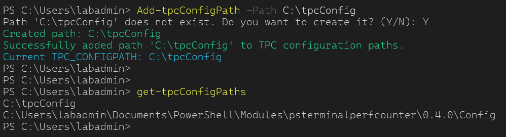

```powershell
# List all Counterconfigs and details in all paths
Test-tpcAvailableCounterConfig
```

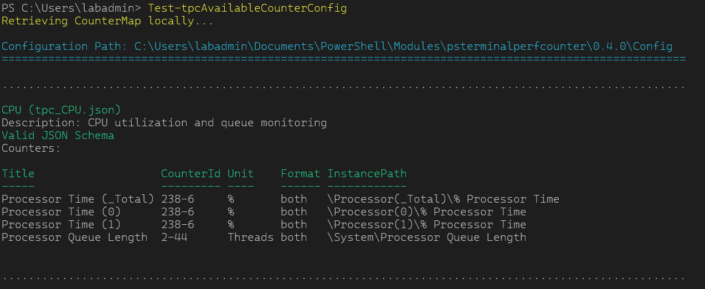

# Single Server Monitoring

The fastest method is a single server, local or remote.

```powershell
# Use CPU Config locally
Start-tpcMonitor -Configname CPU
Start-tpcMonitor -Confipath 'C:\Users\labadmin\Documents\PowerShell\Modules\psterminalperfcounter\0.4.0\Config\tpc_CPU.json'

# Use CPU Config remote
Start-tpcMonitor -Computername 'dev-node1' -Configname CPU
Start-tpcMonitor -Computername 'dev-node1' -Confipath 'C:\Users\labadmin\Documents\PowerShell\Modules\psterminalperfcounter\0.4.0\Config\tpc_CPU.json'

# Use CPU Config rmeote with different credentials
Start-tpcMonitor -Computername 'dev-node1' -Credentials $(Get-Credential) -Configname CPU
```

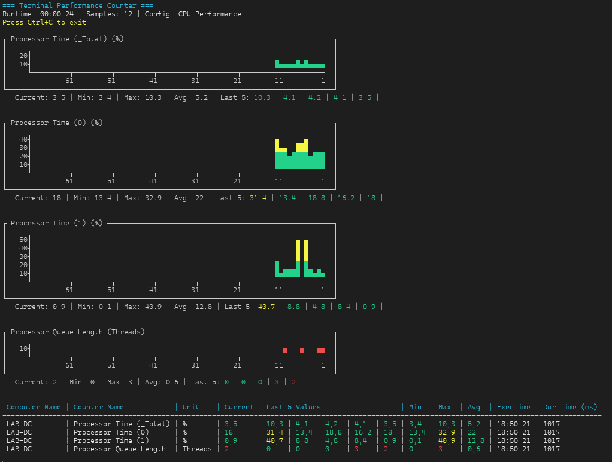

Since the legacy visualization reaches its limits at the latest with multi-server environments, I use the `-TUI` switch for this hands-on.

```powershell
# Use CPU Config locally with TUI
Start-tpcMonitor -Configname CPU -TUI
```

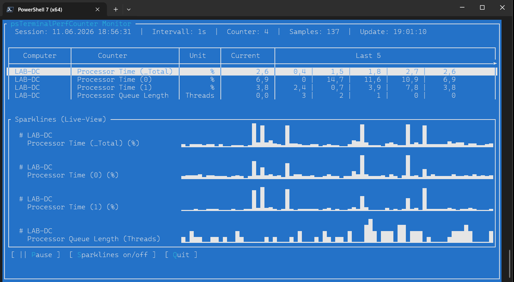

# Multi Server Monitoring

Multi-server monitoring also works via configuration files, although while writing these lines it occurs to me: why did I never think of simply running a counter config against a server list? Onto the backlog with that. Anyway, in the environment configuration you can define any number of servers with different configs. Since I recently still had trouble making the sparklines in the TUI scrollable, they are disabled in the multi-server view.

```powershell
# Start multi server monitoring
Start-tpcEnvironmentMonitor -EnvConfigPath 'C:\tpcConfig\ENV_SERVER_EXAMPLE.json' -TUI
```

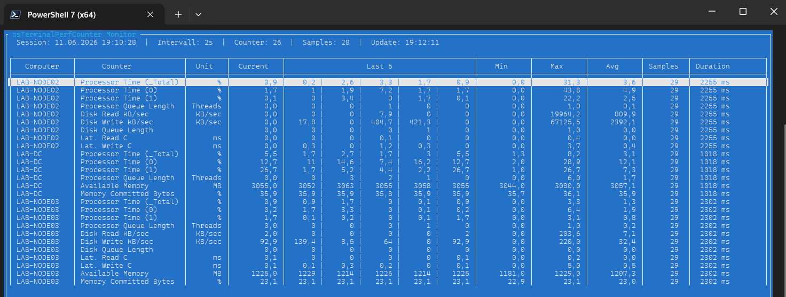

*LAB-NODE03 is a German installation in this case*

The Duration column shows the time the function needed on each server to collect all values. The final timestamp of the entire data set is always defined by the slowest server, as only this way is a homogeneous time series possible. A variance of, in this case, 1.3 seconds cannot be avoided here.

That’s all there is to running it, since this module only provides the framework. The actual life comes with the counter configs. Let’s now take a look at how these are created.

# Creating Counter Configs

In the beginning there is the performance counter. Before we can write the configuration, we need the counter IDs instead of the localized names. For that there is `Get-tpcPerformanceCounterInfo`, which works in both directions: counter path to ID and vice versa.

```powershell
# List all counter and counter objects containing 'processor time'
Get-tpcPerformanceCounterInfo -ComputerName 'dev-node1' -SearchTerm 'processor time'
```

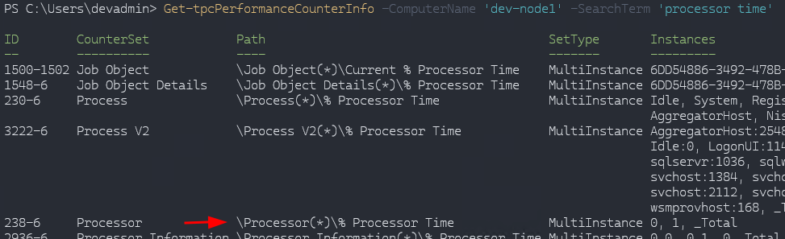

The last two columns are important. There are single-instance counters with only one value, but also multi-instance counters like the Processor counter set, where each instance corresponds to a core, or the total (`_Total`).

In the same way you can use the cmdlet to find out which counter is hidden behind a composite ID.

```powershell
# Show counter name of composite ID
Get-tpcPerformanceCounterInfo -ComputerName 'dev-node1' -SearchTerm '238-6'
```

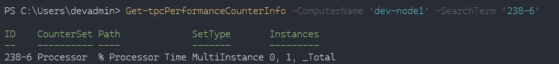

Or on a German system

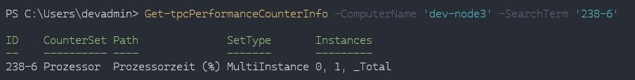

Let’s also take counters that are not present by default on a Windows system: SQL Server. DEV22A in this case is the first instance on the system.

```powershell
# "Out-String -Stream" converts PowerShell's internal formatting objects into actual strings line by
# line, enabling string operations like `Select-String` to work on them.

Get-tpcPerformanceCounterInfo -ComputerName 'dev-node1' -SearchTerm 'dev22a' |
		Out-String -Stream |
		Select-String "lookup"
```

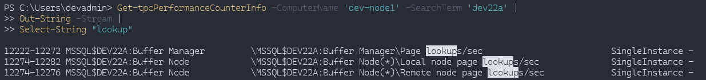

Let’s take `Page lookups/sec` for testing –> 12222-12272

```powershell
Get-tpcPerformanceCounterInfo -ComputerName 'dev-node1' -SearchTerm 'dev22a' |
		Out-String -Stream |
		Select-String "log flushes"
```

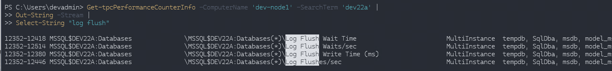

And `log flush/sec` on the TempDB instance –> 12352-12446

The minimal config then looks like this. Some values are missing for the SQL Server counters, but that is not SQL Server specific, it shows that most fields receive defaults. Details on this can be found in the docs in the repo. Also worth mentioning: for CPU I use `"counterInstance": "1|2"`, which automatically creates two counters, and for the page lookups the conversion by 1000 so that the numbers stay readable.\\

```json
{
	"name": "CPU and Sql Server Page Usage",
	"description": "CPU Usage",
	"counters": [
		{
			"title": "CPU Usage",
			"unit": "%",
			"conversionFactor": 1,
			"conversionExponent": 1,
			"conversionType": "D",
			"format": "table",
			"counterID": "238-6",
			"counterSetType": "MultiInstance",
			"counterInstance": "0|1",
			"colorMap": {
				"20": "Green",
				"50": "Yellow",
				"70": "RED"
			}
		},
		{
			"title": "Sql DEV22A Page Lookups/s",
			"unit": "#K",
			"conversionFactor": 1000,
			"conversionExponent": 1,
			"conversionType": "D",
			"counterID": "12222-12272",
			"counterSetType": "SingleInstance",
			"counterInstance": ""
		},
		{
			"title": "Sql DEV22A TempDB Log Flushes/s",
			"unit": "#",
			"counterID": "12352-12446",
			"counterSetType": "MultiInstance",
			"counterInstance": "tempdb"
		}

	]
}
```

Then save the whole thing in a registered path with the prefix `tpc_NAME.json` and off we go.

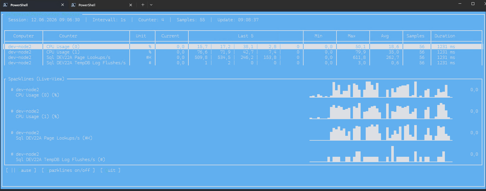

# Monitoring an Environment with an Environment File

No magic here either. Config names or paths can be specified. A function that is not yet fully documented is the use of SecretVaults: via the PowerShell connectors, credentials can be loaded from almost all common solutions, which also gives non-admins the ability to monitor systems.

```json
[
    {
        "name": "SQL_ENVIRONMENT_001",
        "description": "SQL Server Environment Production",
        "interval": 2,
        "secretvaultname": "SecretStore",
        "credentialname": "integrated",
        "servers": [
            {
                "computername": "DEV-NODE1",
                "comment": "Sql Server Node A Production",
                "counterConfig": [
                    "SQLDEMO"
                ]
            },
            {
                "computername": "DEV-NODE2",
                "comment": "Sql Server Node B Production",
                "counterConfig": [
                    "C:\Users\devadmin\Desktop\tpc_SQLDEMO.json"
                ]
            }
        ]
    }
]
```

```powershell
# without TUI
Start-tpcEnvironmentMonitor -EnvConfigPath "C:\Users\devadmin\Desktop\ENV_SERVER_EXAMPLE2.json"
```

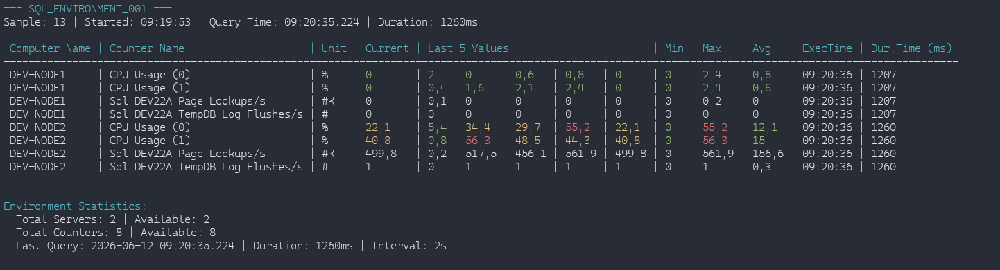

# Data Export

## CSV

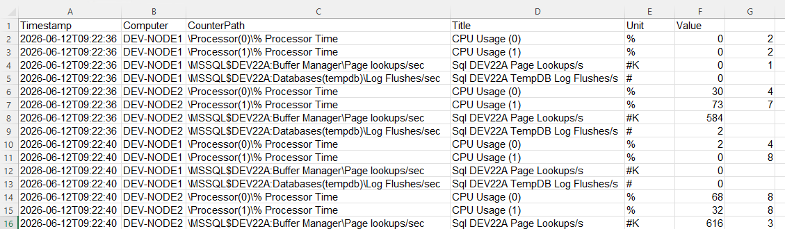

To reuse the time series, you can export to CSV. Caution, currently still a known bug: the export is comma-separated, so values containing a comma get split as well, fixed in 0.4.1.

```powershell
# -CsvPath is default desktop
	Start-tpcEnvironmentMonitor -EnvConfigPath "C:\Users\devadmin\Desktop\ENV_SERVER_EXAMPLE2.json" -ExportCsv
```

# HTML Report

An alternative visualization as HTML, useful when I want to pass on a time series without bothering with Excel or other tools. Grouping can be done by counter or by server, depending on whether, with multiple servers, I want to see all counters of one server in a single chart, or one specific counter across multiple servers. Details on this can be found in the docs in the repo.

To note: the HTML contains a rolling data set bound to the maximum number of samples. The more samples, the more sluggish the HTML becomes. For large time series, better use CSV.

```powershell
# -HTMLPath is default desktop
	Start-tpcEnvironmentMonitor -EnvConfigPath "C:\Users\devadmin\Desktop\ENV_SERVER_EXAMPLE2.json" -ExportHTML
```

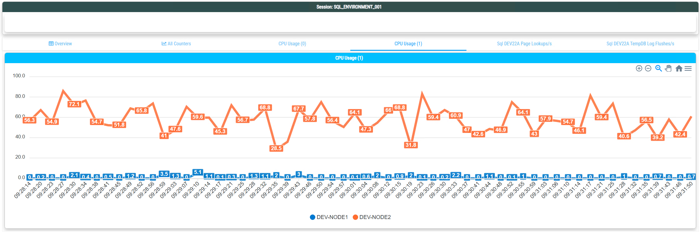

That’s it as a quick start, more details on the individual functions can be found, as always, in the docs and the [README](https://github.com/gabrielkoehl/psTerminalPerfCounter/blob/main/README.md)in the repository.


