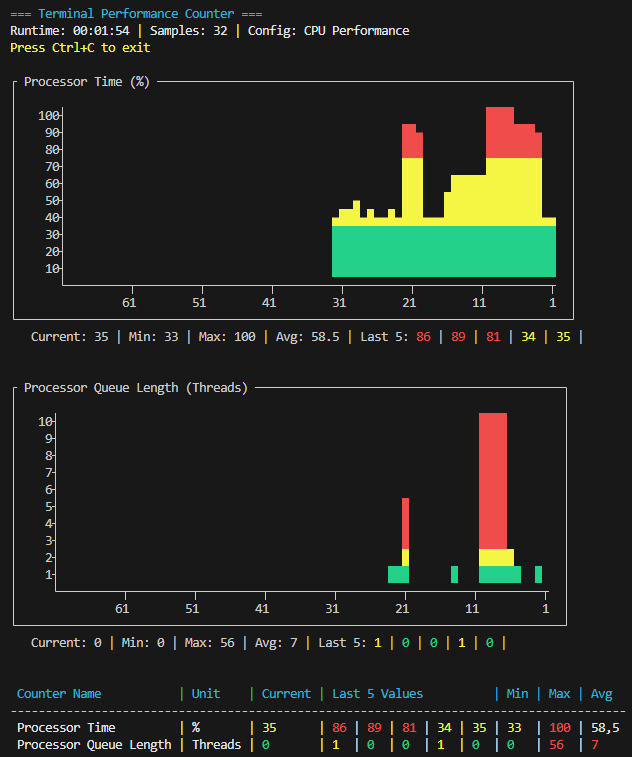
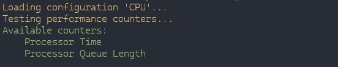
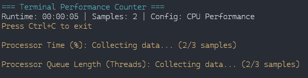
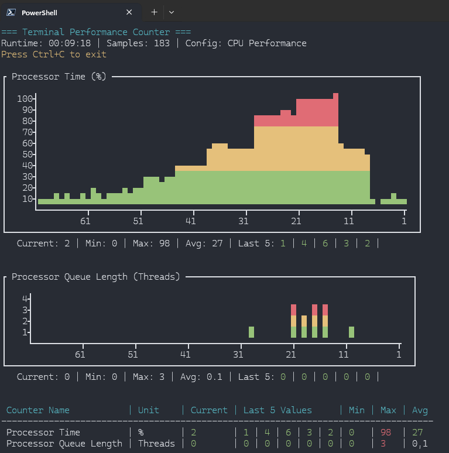
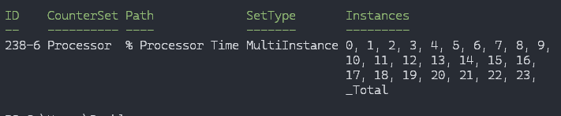
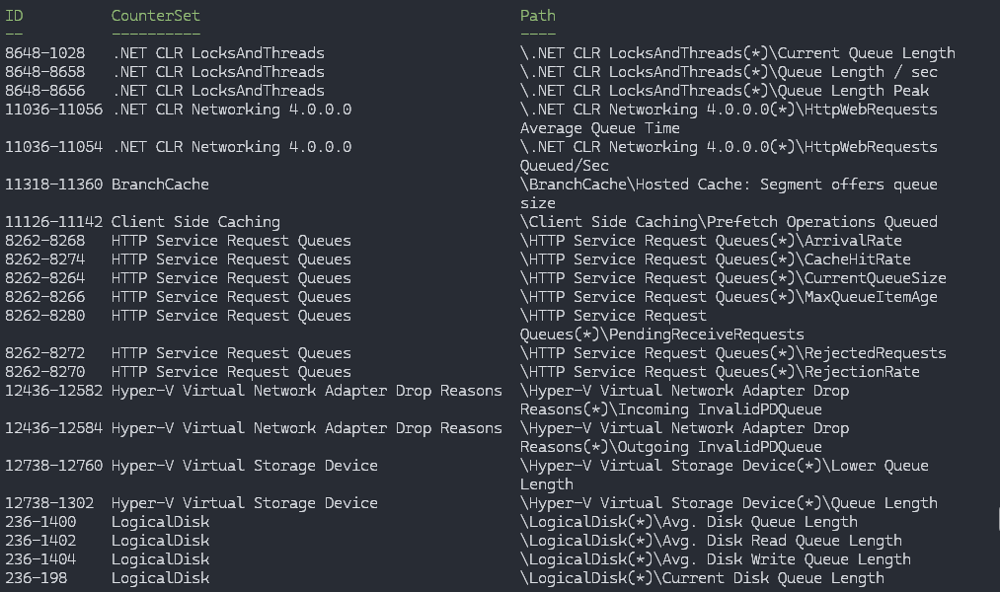
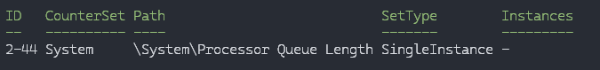

## Current Release ( 2026-06-08 )

[psTerminalPerfCounter 0.4.0](https://www.powershellgallery.com/packages/psTerminalPerfCounter "A PowerShell module for displaying real-time graphs of Windows Performance Counters directly in the terminal console. This module provides an easy way to visualize system performance metrics without requiring external graphing tools or GUI applications by using templates and multilanguage support.")

- [Changelog](https://github.com/gabrielkoehl/psTerminalPerfCounter/blob/main/CHANGELOG.md)
- [Documentation](https://github.com/gabrielkoehl/psTerminalPerfCounter/tree/main?tab=readme-ov-file#documentation)

## Intro

Die Windows Performance Counter sind absolut mächtig, aber wenn es mal schnell gehen muss oder ich genau passend zu einem Problem ein Monitoring benötige, bin ich schnell genervt. Meistens nutze ich dann doch andere Möglichkeiten, PowerShell Native Get-Counter, CIM oder greife auf vorhandene Monitoring-Lösungen bei meinen Kunden zurück. Aber auch das geht nie AdHoc aber ich habe es akzeptiert.

Nun habe ich beim letzten DataSaturday Uwe Ricken beim Performance Tuning Workshop begleiten dürfen und auch er hat die Performance Counter noch mal klar als Musthave im Werkzeugkoffer eines jeden DBA benannt. Was mir bis dahin nicht bewusst war: SQL Server legt individuelle Counter wie **Compile/sec**, **AdHoc Queries/sec** usw. an.


Die Möglichkeiten, Abhängigkeiten direkt zu visualisieren – endlos. Aber wie lange soll ich da sitzen, bis ich das im Windows Performance Monitor abgebildet habe, am besten Adhoc bei einem Kunden?

Uwe zeigte die Möglichkeiten im **Windows Admin Center** auf, welches Templates ermöglicht, die man flexibel auf Servern nutzen kann. Für System oder Umgebungen, in denen das Admin Center strategisch genutzt wird, definitiv eine sehr gut Wahl.

Aber zwei Probleme bleiben: Als Berater kann ich nicht bei jedem Kunden erst Software installieren und wenn das Admin Center doch läuft, scheitern meine englischen Templates an deutschen Systemen.

Nun war ich trotzdem so unglaublich angefixt von der Template-Idee und den Sql Server Möglichkeiten, dass nach Feierabend 4 Wochen Crunchtime im Kopf waren. Somit möchte ich euch an dieser Stelle mein erstes Modul in der PowerShell Gallery vorstellen

[psTerminalPerfCounter 0.1.0-preview](https://www.powershellgallery.com/packages/psTerminalPerfCounter/0.1.0-preview "A PowerShell module for displaying real-time graphs of Windows Performance Counters directly in the terminal console. This module provides an easy way to visualize system performance metrics without requiring external graphing tools or GUI applications by using templates and multilanguage support.")

Die technischen Details, Entwicklungsstand findet ihr alle im Repository, ich möchte hier einfach die verschiedenen Möglichkeiten zeigen.

## Main Features

### 100% PowerShell

- keine externen Abhängigkeiten

### Terminal-Grafiken

- natürlich ist es keine richtige Engine, je mehr Counter desto Hakeliger wird es, aber es reicht
- Als Basis dient die Lösung von [Prateek Singh](https://github.com/PrateekKumarSingh/Graphical). Ohne diesen Fund hätte ich wohl dieses Problem erst lösen müssen, wofür ich vermutlich keine Zeit gehabt hätte. DANKE!!!



### Configuration Templates

- jedes Element der Ausgabe wird über Configuration Files gesteuert
- flexibel, transportabel

### Individualisierung der Datenausgaben

- für jeden Counter im Configuration-File kann eine eigene Ausgabe genutzt werden
  - Table, Graph oder Beide
- beliebige Skalierungen der Achsen in Steps und Max
- beliebige Einfärbung der Values auf Basis einer benutzerdefinierten ColorMap per Counter
- Konvertierung der Values per Configuration-File ( Byte -> KB -> MB -> GB )

### Sprachunabhängig

- Configuration Files basieren nicht auf den Counter-Pfaden sondern IDs
- immer noch transportabel, egal welche Systemsprache
- Translation von ID zu Counterpfad erfolgt erst zur Laufzeit

- keine externen Abhängigkeiten
- Ich wusste gar nicht, dass dies möglich ist mit Windows Bordmitteln. Auch hier bin ich durch Zufall über einen Blog gestolpert bei [PowerShell.ONE](https://powershell.one/tricks/performance/performance-counters). Auch hier ein dickes DANKE!!! Meine eigentliche Lösung sah mehrere Sprachvarianten ( DE, EN, FR, ES) vor, welche dann per auslesen der Systemlokalen gesetzt wurden.

## Demo mit CPU Configuration

```powershell
# Install module with required dependency (GripDevJsonSchemaValidator)
Install-Module -Name psTerminalPerfCounter -AllowPrerelease

# Import the module
Import-Module psTerminalPerfCounter

# Start Default Cpu Configuration
Start-tpcMonitor -ConfigName CPU
```

Beim Laden der Konfiguration werden die Counter IDs zu Counterpfaden übersetzt und getestet



Wenn das erfolgreich war, werden die ersten Samples gesammelt, damit ein Graph angezeigt werden kann



Thats IT!

Innerhalb von 10 Sekunden 2 Performance Counter am Laufen, ohne Installation, ohne Sprachprobleme.



## Demo Counter Translation

```powershell
# Translate ID -> Path
Get-tpcPerformanceCounterInfo 238-6
```



```powershell
# Search Counter -> Including ID
Get-tpcPerformanceCounterInfo "Queue"
```



*Die Ausgabe ist stark beschnitten, da das ResultSet enorm ist*

```powershell
# Search Counter -> Including ID
Get-tpcPerformanceCounterInfo "Processor Queue"
```



## Wie geht’s weiter?

Die Basis läuft, die planned Feature [Liste](https://github.com/gabrielkoehl/psTerminalPerfCounter/blob/main/docs/en-US/DevelopmentStatus.MD) ist lang und das, was ich wirklich brauche bezüglich Sql Server ist noch in weiter Ferne. Ich hoffe ich habe nicht ein Problem bedient, was es gar nicht gibt, aber dieses Modul adressiert einfach alle Probleme, die ich schon immer mit den Performance Countern hatte, siehe oben.

Weiterhin ist das mein erstes größeres Projekt, was ich Public entwickle, somit könnte Github nicht immer den erwarteten Standards entsprechen. Über Feedback und Hinweise freue ich mich immer.


[GitHub – gabrielkoehl/psTerminalPerfCounter: psTerminalPerfCounter is a PowerShell module that provides predefined, language-independent performance counter configurations for real-time terminal-based monitoring, enabling admins to quickly deploy tailored system performance presets with graphical visualization instead of manually configuring Windows Performance Monitor.](https://github.com/gabrielkoehl/psTerminalPerfCounter "psTerminalPerfCounter is a PowerShell module that provides predefined, language-independent performance counter configurations for real-time terminal-based monitoring, enabling admins to quickly de…")
