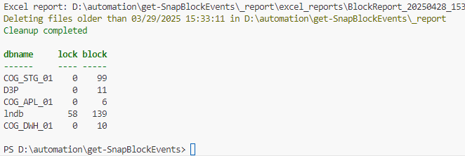
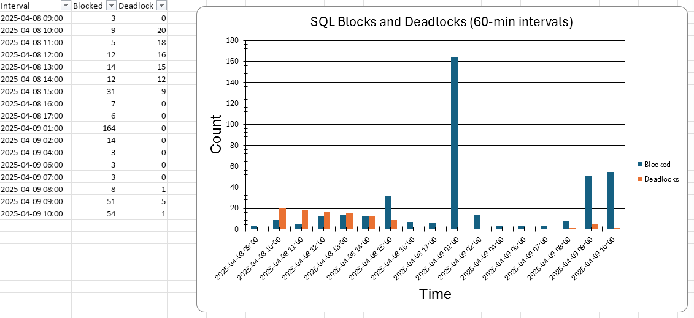

Zu wissen, dass SQL Server Blocking- oder Deadlock-Probleme hat, ist noch ziemlich einfach. Man merkt das normalerweise in der Anwendung und mit den richtigen Queries kann man auch die entsprechenden Blocking-Ketten anzeigen. Am einfachsten geht das mit [http://whoisactive.com](http://whoisactive.com).

```sql
SELECT
    blocking_session_id   AS blocking_session,
    session_id            AS blocked_session,
    wait_time / 1000.0    AS waiting_sec,
    wait_type             AS waittype,
    resource_description  AS ressource
FROM
    sys.dm_os_waiting_tasks
WHERE
    blocking_session_id IS NOT NULL
ORDER BY
    wait_time DESC
```

Ich hab auch noch eine eigene Entwicklung dazu, die werde ich in einem späteren Blogpost vorstellen, die meinen individuellen Anforderungen besser entspricht.

## Das Problem

Jetzt kann ich AdHoc Blockings anzeigen, aber bei Deadlocks wird’s interessanter. Dafür muss die System Health Session gecheckt werden, die ist auch noch flüchtig.

```sql
-- Query System Health Session for Deadlocks

SELECT
    event_data.value('(event/@timestamp)[1]', 'datetime2') AS DeadlockDateTime,
    event_data.query('.')                                  AS DeadlockGraph
FROM
(
    SELECT
        CAST(target_data AS XML) AS target_data
    FROM
        sys.dm_xe_session_targets AS st
    JOIN
        sys.dm_xe_sessions AS s ON s.address = st.event_session_address
    WHERE
             s.name = 'system_health'
        AND st.target_name = 'ring_buffer'
) AS data
CROSS APPLY
    target_data.nodes('//RingBufferTarget/event[@name="xml_deadlock_report"]') AS XEventData(event_data)
ORDER BY
    DeadlockDateTime DESC;
```

Dieses Problem hatte ich bei einem Kunden, der extrem mit Deadlocks in einer 3rd Party Anwendung zu kämpfen hatte, aber der Support war bisschen… sagen wir mal zurückhaltend. 😉

Wir mussten denen alles transparent melden, damit die anfangen eine Lösung zu finden. Query-Resultsets kann man natürlich als transparent betrachten, wenn man sie versteht oder verstehen will. Leider sind die XML von Health Sessions oder Extended Events nicht gerade dafür berühmt, lesbar zu sein. Der Kunde wollte aber einfach nur, dass das Problem gelöst wird.

Also haben wir gemeinsam eine Reporting-Lösung entwickelt.

## Die Idee

Mit Extended Events hab ich XML-Daten und mit PowerShell kann ich XML parsen wie ich will, auch zu einem Report meiner Wahl.

## Das Ziel

Wir wollten eine Möglichkeit, abseits von SQL Server Resultsets, Anwendungsprobleme mit Anomalien in den SQL Server Metriken zu überlagern, um schnell Lösungen herbeizuführen.

In der Woche nach dem Livegang der Lösung gab’s viele, viele „Aha“-Momente. Von falsch konfigurierten ERP-Parametern bis hin zu schlechtem Transaction-Handling.

## Der Weg

### Persistente Daten

Das Wichtigste ist, Blocking Session und Deadlock Events persistent zu speichern. Das geht perfekt mit Extended Events. Dafür gibt’s zwei Bereiche:

```sql
-- SNIPPET!!

ADD EVENT sqlserver.blocked_process_report(
    ACTION(sqlserver.client_app_name,
           sqlserver.client_hostname,
           sqlserver.database_name)
),
ADD EVENT sqlserver.xml_deadlock_report(
    ACTION(sqlserver.client_app_name,
           sqlserver.client_hostname,
           sqlserver.database_name)
)
```

Das ganze wird in einem eigenen Extended Event konfiguriert und die Aufzeichnungen laufen bereits. **Fast!** Wir müssen noch SQL Server konfigurieren, damit Blocked Process als Extended Events behandelt werden.

```sql
EXEC sp_configure 'show advanced options', 1;
GO
RECONFIGURE;
GO
EXEC sp_configure 'blocked process threshold', '5'; -- 5 Sekunden
RECONFIGURE
GO
```

### Daten auslesen

### 100% PowerShell

Nachdem die Events geloggt werden, müssen sie ausgewertet werden. Was mir sofort eingefallen ist, waren die dbatools mit [Read-DbaXEFile](https://docs.dbatools.io/Read-DbaXEFile.html). Das Problem ist, dass die aktuell geschriebene Datei damit nicht gelesen werden kann. Du kannst dir vorstellen, dass Blocking- und Deadlock-Events nicht in solchen Massen auftreten, dass dutzende File-Rotationen innerhalb von 24h durchgeführt werden. Falls doch, hast du definitiv ein anderes Problem als es nur zu reporten. Also haben wir den Umweg über SQL Server genommen, da auch hier die aktuelle Datei gelesen werden kann.

### PowerShell + TSql

XML mit Queries zu lesen, fällt mir immer noch sehr schwer, aber DANKE an Brent Ozar, uns allen bekannt, für die [grundlegende Query](https://www.brentozar.com/archive/2014/03/extended-events-doesnt-hard/), auf der ich aufbauen konnte. Zumindest hatte ich jetzt ein Resultset zur Orientierung und ein separates XML für jedes Event im Log.

```sql
-- Snippet
select
    *
FROM sys.fn_xe_file_target_read_file
   ('C:\temp\XEventSessions\blocked_process*.xel',
    'C:\temp\XEventSessions\blocked_process*.xem',
     null, null)
CROSS APPLY
    (SELECT CAST(event_data AS XML) AS event_data) as xevents
```

### Finalisierung mit PowerShell

Da ich endlich mein XML-Event hatte, konnte ich es mit PowerShell parsen, transformieren und letztendlich in einen schönen Text-Report verpacken.

```text
Sql Server Deadlock Analysis | Event Time: 2025-04-08T11:16:07.447
================================================================================

SQL STATEMENTS INVOLVED
--------------------------------------------------------------------------------

    Process ID:   process261b00cfc28
    SPID:         643
    Database:     DATABASENAME
    Query:        **DETAILED QUERY**

----------------------------------------

    Process ID:   process258294fbc28
    SPID:         650
    Database:     DATABASENAME
    Query:        **DETAILED QUERY**

----------------------------------------

VICTIM LIST
--------------------------------------------------------------------------------

    Process ID:   process261b00cfc28
    SPID:         643
    Database:     DATABASENAME

PROCESS LIST
--------------------------------------------------------------------------------

    Process ID:               process261b00cfc28
    SPID:                     643
    Isolation Level:          read uncommitted (1)
    Logical Reads:            700
    Wait Resource:            KEY: 6:72058005407662080 (fb04e1bc7788)
    Wait Time (ms):           2247
    Transaction:              user_transaction
    Last Transaction Started: 2025-04-08T11:16:07.447
    Client:                   'dbserver_dll &lt;ID@APPSERVER:34784>'
    Hostname:                 APPSERVER
    User:                     USERNAME

EXECUTED SQL STATEMENT
----------------------------------------

    **DETAILED QUERY**

Process Details
================================================================================

    Process ID:               process258294fbc28
    SPID:                     650
    Isolation Level:          read uncommitted (1)
    Logical Reads:            1904
    Wait Resource:            KEY: 6:72057996178358272 (2a9726d2d061)
    Wait Time (ms):           2278
    Transaction:              user_transaction
    Last Transaction Started: 2025-04-08T11:16:07.330
    Client:                   'dbserver_dll &lt;ID@APPSERVER:11664>'
    Hostname:                 APPSERVER
    User:                     USERNAME

EXECUTED SQL STATEMENT
----------------------------------------

    **DETAILED QUERY**

Process Details
================================================================================

RESOURCE LIST
--------------------------------------------------------------------------------

    Resource:
        Type:               keylock
        Database:           6
        Object:             DATABASENAME.dbo.tcprmp300100
        Index:              Itcprmp300100_1a
        Lock Mode:          X
        HOBT ID:            72058005407662080
        Associated Object ID: 72058005407662080

    Owners:
        Process ID:         process258294fbc28, Mode: X

    Waiting Processes:
        Process ID:         process261b00cfc28, Mode: U, Request Type: wait

================================================================================

    Resource:
        Type:               keylock
        Database:           6
        Object:             DATABASENAME.dbo.tcprrp011100
        Index:              Itcprrp011100_1a
        Lock Mode:          X
        HOBT ID:            72057996178358272
        Associated Object ID: 72057996178358272

    Owners:
        Process ID:         process261b00cfc28, Mode: X

    Waiting Processes:
        Process ID:         process258294fbc28, Mode: U, Request Type: wait

================================================================================
```

### Umsetzung

Es wurde gewünscht, die Ergebnisse in den Daily Report zu integrieren, den wir bereits mit PowerShell umgesetzt hatten. Jetzt ist es nicht geil, potenziell jeden Morgen 200 Textdateien an eine E-Mail zu hängen, deshalb gibt das PowerShell-Script eine Tabelle zurück, die zeigt, wie Blocks und Locks in Zeitraum X aufgetreten sind, und bei Bedarf kann man proaktiv die Ordnerstruktur checken.



Für den dramatischen Effekt und schnellen Überblick wird auch noch eine Excel-Datei generiert. In diesem Beispiel gab’s einen schönen Kollateralfund, dass die DWH-Jobs massive Probleme hatten 🙂



Und schon hatten wir ein paar Reports, die wir dem Vendor in die Hand drücken konnten, und dann ging’s sehr schnell.

```text
Die Ordnerstruktur

_report/
├── text_reports/
│   └── YYYY/
│       └── MM/
│           └── DD/
│               ├── 20231120_123456_dbname_blocked.txt
│               ├── 20231120_123456_dbname_blocked.xml
│               └── 20231120_123456_dbname_deadlock.txt
└── excel_reports/
    └── BlockReport_20231120_123456.xlsx
```

**Leider erlebe ich immer wieder, dass Anwendungsvendoren denken, ihre Kunden sind zu blöd und können die Anwendung nicht bedienen. Hört auf damit und glaubt euren Kunden manchmal auch ohne 101% Daten, die man nur sammeln kann, wenn man bereits Sachkenntnis hat.**

## Repository ansehen

[GitHub – gabrielkoehl/get-snapBlockEvents: SQL Server Block Event Reporter that automatically captures, analyzes, and visualizes blocking events and deadlocks using PowerShell and Extended Events, providing detailed text reports and aggregated Excel summaries.](https://github.com/gabrielkoehl/get-snapBlockEvents "GitHub – gabrielkoehl/get-snapBlockEvents: SQL Server Block Event Reporter that automatically captures, analyzes, and visualizes blocking events and deadlocks using PowerShell and Extended Events, providing detailed text reports and aggregated Excel summaries.")

Das Script hat verschiedene Parameter und Optionen, Details stehen in der README.MD. Falls du Fragen hast, lass sie in den Kommentaren oder kontaktier mich.

## Anderes

Erik Darling hat auch eine Lösung entwickelt, um Extended Events lesbar zu machen, falls andere Ansätze gebraucht werden. ([sp_HumanEvents](https://github.com/erikdarlingdata/DarlingData/tree/main/sp_HumanEvents))


**Gabriel, der DBAvonNebenan**
