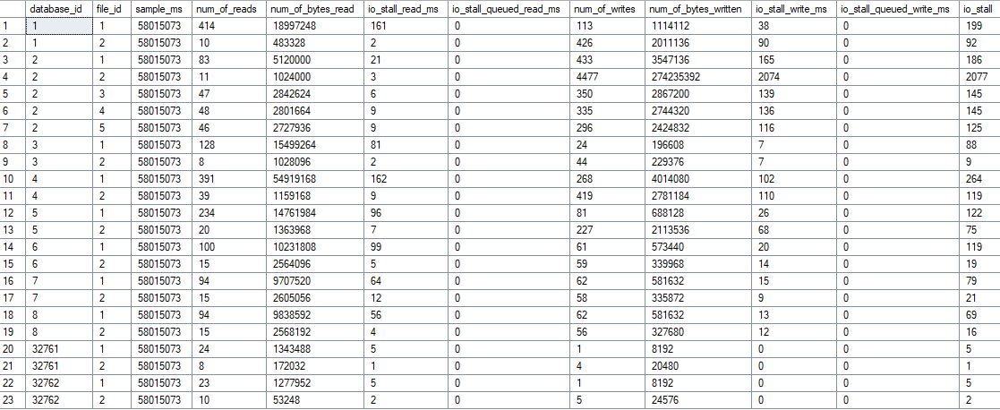
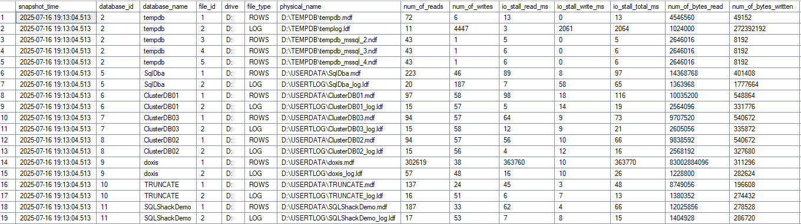
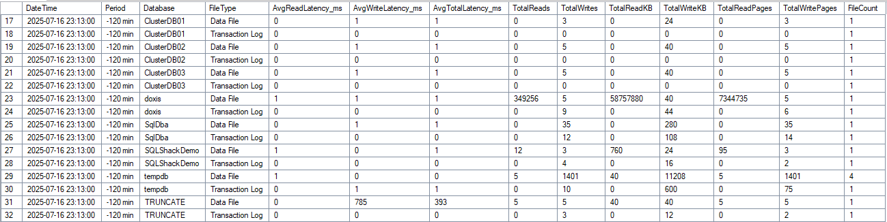
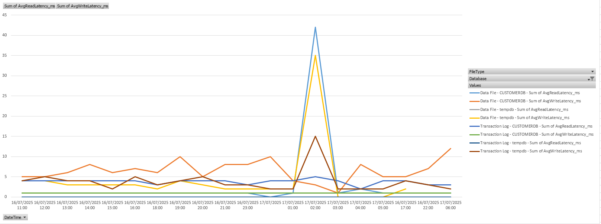

> What’s available here?
>
> - [DISKSPD Templates and Wrapper](#DISKSPD)
> - [How can I display the latencies of individual database files?](#sqlfilestats)
> - [Long-term analysis of latencies with snapDiskLatency](#snapdisk)

[GitHub – gabrielkoehl/DBAScriptBox: Useful stuff for DBAs](https://github.com/gabrielkoehl/DBAScriptBox)

## Intro

Currently, I’m involved in a code review at a client. We’re examining not only the application but also all interfaces. This naturally includes the SQL Server landscape, which I set up at the beginning of the year.

The result was more findings in my direction than expected, and I immediately felt challenged. I was able to refute most of it, some topics were the client’s responsibility, and one topic caught my interest purely out of curiosity.

**Read- and Write Latencies of TempDB** ( and every other DB )


## Background

The client doesn’t operate their own data center, so they’re dependent on the hoster, who unfortunately isn’t very communicative. Therefore, I had to get a picture of the totally overcommitted hardware through various other means and challenge the hoster. This was also the reason why I was quite precisely informed about what the hoster’s hosts and storage systems were capable of delivering.

That’s why I was very surprised that 32ms Write Latency was listed as a finding. No question, that’s a bad value for AllFlash NVMe, but it just stood there in the report without differentiation or deeper analysis. Just the statement „bad storage.“ So I unpacked my tools, took another look at it, and also developed a new solution that I want to share with you.

## DISKSPD {#DISKSPD}

***Repo**: perf_diskspeed/DISKSPD*  
***Microsoft*:** [https://github.com/microsoft/diskspd](https://github.com/microsoft/diskspd)

With DISKSPD, you should always start on unknown systems; often a large portion of problems is hidden here. At this client, for example, a DB with high workload was running on spindles, with latencies in the .2 percentile of 15 seconds latency, plus 14MB throughput. I don’t need to worry about indexes etc. anymore.

To quickly get results, I built a wrapper for DISKSPD that always executes 3 standard tests:

- SQL Server Workload
- Random 64KB Workload
- Sequential 64KB Workload

The files are stored separately in the \_Output subfolder and thus provide quite good hints about storage problems. Now these were, as expected, great values that correspond to NVMe storage. So let’s continue to SQL Server and see what it tells us. welche NVMe Storage entsprechen. Also weiter zu Sql Server und wir schauen mal was uns dieser so sagt.

## sys.dm_io_virtual_file_stats {#sqlfilestats}

SQL Server provides a view where all file metrics are cleanly listed.

```sql
select * from sys.dm_io_virtual_file_stats(null,null)
```

- [Microsoft Learn](https://learn.microsoft.com/en-us/sql/relational-databases/system-dynamic-management-views/sys-dm-io-virtual-file-stats-transact-sql?view=sql-server-ver17)



Based on this, I built an analysis script that gives me more info and I can also draw further conclusions like ReadWrite Ratio, probable IOPS based on the number of operations, and also quantities. This allows you to build storage systems quite well for specific workloads.

And this value also showed me 32ms Write Latency of the TempDB. Then I started wondering, how does this value even arise?


### Basic Calculation

SQL Server measures I/O latency through simple division of cumulative wait times by the number of operations:

```sql
-- Read Latency in ms
io_stall_read_ms / num_of_reads = durchschnittliche Read-Latenz

-- Write Latency in ms
io_stall_write_ms / num_of_writes = durchschnittliche Write-Latenz
```

That’s it!!! And now it should be clear that the point-in-time use of this DMV is not really meaningful, on the contrary. The values can, as with the review company that specializes in such processes, lead to false conclusions and action recommendations. Scary.

If the storage system had a hard hiccup since the start of SQL Server, the metrics are contaminated. According to my research, you can’t flush these, only by taking the DB offline, which I usually avoid in productive environments.

After a few more rounds in my head, the solution came quite quickly. These are all snapshot values, I just need the delta between two values and I have real values. And I can also put the whole thing in a time series and have a long-term analysis. Mindblowing 😝

Google also quickly showed corresponding solutions that I used as a base idea. Thanks to Paul Randal ( [sqlskills.com](https://www.sqlskills.com/blogs/paul/capturing-io-latencies-period-time/) )

For analyzing a complete week, this is also not suitable. So I extended the whole thing to a long-term analysis with persistent table.

## The Solution –> snapDiskLatency {#snapdisk}

***Repo**:* perf_diskspeed/snapDiskLatency

### What does snapDiskLatency do?

The problem is well-known – the standard DMV `sys.dm_io_virtual_file_stats` shows cumulative values since SQL Server startup. One single storage hiccup weeks ago and the latency values are no longer representative.

This solves the problem with two simple stored procedures:

The first collects the raw data from the DMV hourly and writes it to a permanent table. Why hourly? Shorter intervals lead to unreliable delta calculations – too little I/O between snapshots makes the values inaccurate. However, this can be individually adjusted since the agent triggers the procedure.



The second does the delta calculations between snapshots and creates the result. Thus, real latency values are generated for defined time periods, without historical hiccups, which can then be compared with other metrics.



Here we see, for example, in the [TRUNCATE TABLE](../sql-server-truncate-vs-delete-dml-or-ddl/index.en.md) an outlier (NVMe is also underlying here). On the LAB system there’s no load, DOXIS is just a table with 2 columns and was artificially worked with workload.

### The Result

Instead of possibly contaminated values:

- Average latencies per interval
- Read/Write ratios
- Breakdown by database and file type

### Setup

Create Agent Job, run hourly, done. The complete instructions are in the README, copy & paste & enjoy


## Diagrams

Since every good proprietary database monitoring tool does this and presents it graphically, I want to at least show one possibility in Excel in the result. For this, the result of the DataSource or Copy must be pivoted and you can easily recognize your daily peaks.


