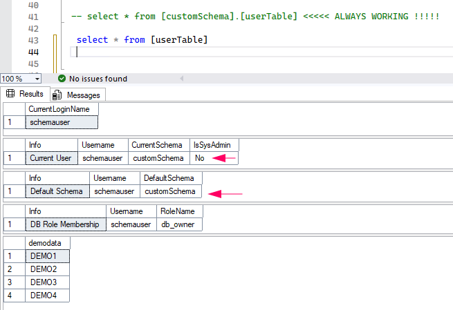
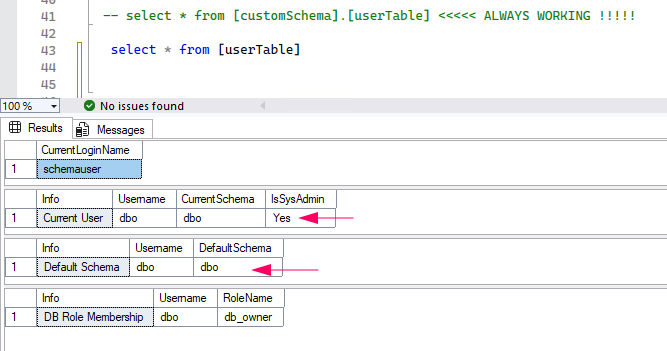
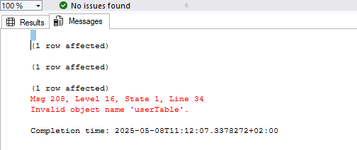

Today I had another call on my desk where an error message from an application stated that an object in the Sql Server DB couldn’t be accessed. The vendor claimed „connection problem“, I said „DB or at least server problem“, customer says „everything used to work before“.

The Extended Events were quickly set up, „Remote Procedure Call Starting“ shows me a statement without a fully qualified table name. The target object is in the database under the db_owner schema. Welllll, that’s already questionable, but OK. Why not keep it as dbo?

Anyway, the behavior at this point was really incomprehensible to me since everything was configured correctly: Default schema of the user, db_owner on the DB. And the SysAdmin. I had noticed that, but well, customer’s decision. I’ll note things like this in a session, but won’t change anything to avoid endangering grown dependencies.

After searching for a long time, I almost gave up, referred to the vendor and ended the call. Unfortunately, I can’t let go of stuff like this, so I fired up the lab, rebuilt the environment and lo and behold, found the error.

The problem is the SysAdmin role. It directly maps the login to the dbo user of the database – regardless of whether the actual user exists or not, thus inheriting dbo’s default schema. Mindblowing, didn’t know that. 🙂

## SysAdmin Role InActive



## SysAdmin Role Active





---



```sql
DECLARE @IsSysAdmin INT
SELECT @IsSysAdmin = IS_SRVROLEMEMBER('sysadmin')

SELECT SYSTEM_USER AS CurrentLoginName;

SELECT
    'Current User'  AS Info,
    USER_NAME()     AS Username,
    SCHEMA_NAME()   AS CurrentSchema,
    CASE WHEN @IsSysAdmin = 1 THEN 'Yes' ELSE 'No' END
                    AS IsSysAdmin

SELECT
    'Default Schema'        AS Info,
    dp.name                 AS Username,
    dp.default_schema_name AS DefaultSchema
FROM
    sys.database_principals dp
WHERE
    dp.name = USER_NAME()

SELECT
    'DB Role Membership'    AS Info,
    USER_NAME()             AS Username,
    r.name                  AS RoleName
FROM
    sys.database_principals u
JOIN
    sys.database_role_members m ON u.principal_id = m.member_principal_id
JOIN
    sys.database_principals r ON m.role_principal_id = r.principal_id
WHERE
    u.name = USER_NAME()

--------------------

-- select * from [customSchema].[userTable] <<<<< ALWAYS WORKING !!!!!

 select * from [userTable]
```



---

- Always use fully qualified object names, someday you’ll be glad you did. You can read this in many blogs.
- Always work according to POLP ([Principle of Least Privilege](https://en.wikipedia.org/wiki/Principle_of_least_privilege)), an app user shouldn’t have SysAdmin rights! 🙂


**Gabriel, der DBAvonNebenan**
