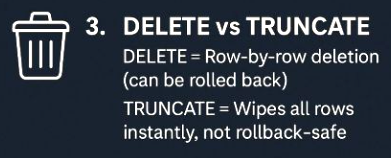

Kürzlich bin ich über einen LinkedIn-Post zu TRUNCATE vs. DELETE gestolpert, wie so viele andere auch. Typischerweise posten zufällige Mitglieder einfache SQL Server Tipps, schön verpackt in Grafiken und allgemein gehalten. Obwohl das für Anfänger absolut legitim ist – da diese einfachen Einstiegspunkte vielen Neulingen helfen können zu verstehen und einen großartigen Startpunkt bieten – ist die Tatsache, dass dieselben Themen dann viral über verschiedene Accounts gehen, klar eine ganz andere Sache.

Wie auch immer. Wenn du beim Thema schon etwas weiter bist und bereits weißt, dass die Aussprache nicht „SQL“ sondern „Sequel“ ist 😊, solltest du diese Posts grundsätzlich hinterfragen, da sie meist verallgemeinern.

So war es auch bei einem Post über die Top 3 SQL-Fehler, die „jeder“ macht. Und hier kommen wir zum Punkt – TRUNCATE TABLE und seine Besonderheiten.

[](https://www.linkedin.com/posts/samiul-fahim_sql-dataengineering-techtips-activity-7328642722653786112-OBfj?utm_source=share&utm_medium=member_desktop&rcm=ACoAACt1yIMBIZu3k0gdHLx7c_luIAnHYYBMtuc)

[LinkedIn](https://www.linkedin.com/posts/samiul-fahim_sql-dataengineering-techtips-activity-7328642722653786112-OBfj?utm_source=share&utm_medium=member_desktop&rcm=ACoAACt1yIMBIZu3k0gdHLx7c_luIAnHYYBMtuc)

Dasselbe passierte mit [Vedran Kesegic](https://www.linkedin.com/in/vedrankesegic/), der den Hinweis gab, dass TRUNCATE TABLE anscheinend rollback-fähig ist, wenn es in einer Transaktion gekapselt wird. Dann sprang [Carsten Saastamoinen-Jakobsen](https://www.linkedin.com/in/saastamoinen/) ein und die Sache wurde wild. So wild, dass mich das ganze Thema dermaßen gepackt hat, dass ich einen Deep Dive gemacht habe. Außerdem fiel in diesem Austausch so viel Wissen ab, dass es schade wäre, wenn es in einem Kommentarbereich verschwindet.

## Was dich hier erwartet – TRUNCATE TABLE im Detail

Ich habe den Austausch verglichen und mir die Kernaussagen angeschaut. Ich habe auch separat mit beiden etwas mehr getextet, und Carsten gab mir Auszüge aus einer seiner Publikationen, wo das Thema technisch behandelt wird.

Technisch gesehen sind sich beide einig, auch wenn sie es nicht sagen 🤣. Aber was am Ende wirklich wild war, war die Frage zum TRUNCATE TABLE Befehl:


Ich kann es vorwegnehmen. Diese Frage zur TRUNCATE TABLE Klassifizierung ist eine philosophische. Ich konnte mir basierend auf meiner Recherche eine Meinung bilden, mehr dazu später, aber grundsätzlich liegt es an jedem selbst zu entscheiden.


---

## Die Diskussion – TRUNCATE TABLE als DML oder DDL?

### Vedran Kesegic

**Kernposition: TRUNCATE TABLE ist DDL**

> „TRUNCATE modifies internal system tables sys.sysallocunits and sys.sysrowsets. DELETE modifies indexes and stats“

> „DML writes data (rows in user tables), while DDL writes metadata (rows in system tables, data that describes other/user objects). Truncate happens to write metadata (system tables) and thus is classified as DDL.“

**Technische Argumente für TRUNCATE TABLE als DDL**

- Verwendet SCH-M (Schema Modification) Lock
- Modifiziert System-Metadaten-Tabellen
- Microsoft-Dokumentation klassifiziert es als DDL
- Loggt Page-Deallocations, nicht Row-Deletions

**Kernaussage zum TRUNCATE TABLE Befehl**

> „TRUNCATE modifies internal system tables sys.sysallocunits and sys.sysrowsets. DELETE modifies indexes and stats – see attached“

### Carsten Saastamoinen-Jakobsen

**Kernposition: TRUNCATE TABLE ist DML**

> „It is not an argument to call TRUNCATE a DDL statement because a certain lock is used! When statements are categorized, it must be based on what happens and not how a given database system solves the task.“

> „We may have to recognize that a previous error categorization should not continue to call TRUNCATE a DDL, but recognize that it is a DML.“

**Logische Argumente für TRUNCATE TABLE als DML**

- Daten werden gelöscht, Struktur bleibt erhalten
- Keine Änderungen an der Tabellendefinition
- Folgt semantischen Regeln der Datenmanipulation
- Kann nur bestimmte Partitionen löschen (nicht alle Daten)

**Kernaussage zur TRUNCATE TABLE Klassifizierung**

> „I say that MS is right in the documentations because they are not telling that TRUNCATE is as DDL, because they know that TRUNCATE is a DML!“
>
> *ANMERKUNG Gabriel*   
> *Ich denke, das ist wirklich etwas fragwürdig, weil die Dokumentation absolut klar* *zu diesem Punkt ist* –> ***DDL*** ([microsoft.com](https://learn.microsoft.com/en-us/sql/t-sql/statements/statements?view=sql-server-ver17#data-definition-language))

**Zitat aus der Publikation zum TRUNCATE TABLE**

> „As of version 2016, it is possible to delete only some of the data in a table with TRUNCATE, so it is even more cor­rect to call it manipulation than definition, because it is changing some of the data but not changing the structure.“

### Einigungspunkte bei TRUNCATE TABLE

- TRUNCATE TABLE kann in einer Transaktion zurückgerollt werden
  - allgemeine Demo bei [sqlauthority.com](https://blog.sqlauthority.com/2010/03/04/sql-server-rollback-truncate-command-in-transaction/)
  - detaillierte Demo [sqlshack.com](https://www.sqlshack.com/the-internals-of-sql-truncate-and-sql-delete-statements/)
- TRUNCATE TABLE ist eine geloggte Operation
- TRUNCATE TABLE ist schneller als DELETE bei großen Datensätzen
- Beide verstehen die technische Implementierung

### Hauptstreitpunkt bei TRUNCATE TABLE

- **Klassifizierungskriterien für TRUNCATE TABLE**
  - Implementierungsdetails
- **Autorität**
  - Vendor-Dokumentation (Vedran) vs. Logische Begründung (Carsten)
- **Perspektive zum TRUNCATE TABLE Befehl**
  - Wie es intern funktioniert (Vedran) vs. Was es funktional macht (Carsten)

### Meine Einschätzung zu TRUNCATE TABLE

Wie du siehst, passt es technisch, aber wie betrachtest du das Ganze? Vielleicht ist es gut, dass ich nicht mit so viel Wissen vorab beladen bin wie beide, denn aus meiner Sicht ist es ziemlich klar: **TRUNCATE TABLE ist DDL!!**

Entgegen Carstens Aussage, dass keine Systemtabellen geändert werden, ist Vedrans Aussage absolut korrekt. Sieh warum…


… und natürlich weil Microsoft sagt, dass TRUNCATE TABLE DDL ist 😊 ( [microsoft.com](https://learn.microsoft.com/en-us/sql/t-sql/statements/statements?view=sql-server-ver17#data-definition-language) )

Und Partitionierung ist DML… ich weiß nicht, auch hier sind es zumindest Systemspalten, die die Partitionierung definieren.

---

## Wie TRUNCATE TABLE funktioniert – Schritt für Schritt

Ich würde gerne sagen, dass ich es einfach beschreibe, aber das ist einfach meine normale Beschreibung. Das Thema TRUNCATE TABLE ist wirklich komplex ✌️

### 1 – TRUNCATE TABLE Befehl initiiert

```sql
TRUNCATE TABLE dbo.MyTable;
```

- **Erste Aktion**: Akquiriert **SCH-M (Schema Modification)** Lock auf gesamte Tabelle
- **Effekt**: Tabelle ist komplett gesperrt – keine Reads, keine Writes, nichts

### 2 – Extents identifizieren bei TRUNCATE TABLE

- DEEP DIVE Extents –> [microsoft.com](https://learn.microsoft.com/en-us/sql/relational-databases/pages-and-extents-architecture-guide?view=sql-server-ver17)
- SQL Server liest IAM-Pages
- Listet alle Extents auf, die zur Tabelle gehören
- **Hält weiterhin**: SCH-M Lock auf Tabelle

### 3 – Einzelne Extents bei TRUNCATE TABLE sperren

- Platziert **X (Exclusive)** Locks auf jeden Extent
- Das sind reguläre Data-Locks, KEINE Schema-Locks
- **Hält jetzt**:
  - SCH-M Lock auf Tabelle (verhindert Zugriff)
  - X Locks auf Extents (markiert sie für Deallocation)

### 4 – TRUNCATE TABLE Operation loggen

- Schreibt ins Transaction-Log: „Deallocate extents 8:8, 8:16, etc.“
- **Hält weiterhin**: Beide Lock-Typen

### 5a – Bei COMMIT der TRUNCATE TABLE Operation

- Aktualisiert IAM – markiert Extents als frei
- **Gibt frei** alle X Locks auf Extents
- **Gibt frei** SCH-M Lock auf Tabelle
- Tabelle ist wieder zugänglich

### 5b – Bei ROLLBACK der TRUNCATE TABLE Operation

- Verwirft Deallocation-Marker
- **Gibt frei** alle X Locks auf Extents
- **Gibt frei** SCH-M Lock auf Tabelle
- Alles bleibt unverändert

### Warum zwei verschiedene Lock-Typen bei TRUNCATE TABLE?

**SCH-M Lock:**

- „Niemand rührt diese Tabelle ÜBERHAUPT an“
- Typisch für DDL-Operationen
- Verhindert sogar Metadaten-Abfragen

**X Locks auf Extents:**

- „Diese spezifischen Datenblöcke werden modifiziert“
- Typisch für Daten-Operationen
- Stellt sicher, dass Extents nicht von anderen Sessions wiederverwendet werden bis commit/rollback

### Meine bescheidene Meinung zu TRUNCATE TABLE

Mit diesem Wissen ist der Fall eigentlich klar für mich, aber wie siehst du es? Tatsächlich werden hier keine Benutzerdaten manipuliert; stattdessen werden System-Level-Zuweisungen angepasst. Folglich erlaube ich mir, trotz meines neuen Halbwissens, den folgenden Vergleich zu ziehen:

„Ich sage auch nicht, dass ich Text in einem Word-Dokument lösche, wenn ich die Festplatte schnell formatiere und nur die Block-Allocation lösche.“


Ja, ich denke das ist ein schöner Vergleich… Fall abgeschlossen, jetzt ein paar technisch interessante Aspekte und Lösungen zum TRUNCATE TABLE Befehl

---

## Technischer Teil, Hacks und TRUNCATE TABLE How-To


… praktisch, nicht technisch 😉

### TRUNCATE TABLE mit Survivor Table (Temporary Table)

Daten, die noch benötigt werden, werden einfach in eine temporäre Tabelle verschoben und nach TRUNCATE TABLE wieder abgerufen

```sql
-- Step 1: Create temp table with rows to keep
	SELECT * INTO #SurvivorRows
	FROM
		MyTable
	WHERE
		DateColumn >= '2024-01-01'

-- Step 2: Truncate the entire table
	TRUNCATE TABLE MyTable

-- Step 3: Re-insert survivor rows
	INSERT INTO MyTable
	SELECT * FROM #SurvivorRows

-- Step 4: Clean up
	DROP TABLE #SurvivorRows
```

### TRUNCATE TABLE mit PARTITION Option (2016++)

Seit SQL Server 2016 (jede Edition) ist es möglich, Partitionen oder Bereiche von Partitionen bei TRUNCATE TABLE zu spezifizieren

```sql
-- Truncate specific partitions
	TRUNCATE TABLE MyPartitionedTable
	     WITH (PARTITIONS (2, 4 TO 6))

-- Check partition status
	SELECT
		 partition_number
		,rows
	FROM
		sys.partitions
	WHERE
		OBJECT_NAME(OBJECT_ID) = 'MyPartitionedTable'
```

### TRUNCATE TABLE ist immer eine Transaktion…

…. und muss beim RESTORE berücksichtigt werden. Carsten hat das ganze sehr schön in seiner Publikation illustriert. Ich beschreibe es nur, das muss an dieser Stelle reichen 😝

Obwohl wir nur **TRUNCATE TABLE** schreiben, verwendet SQL Server trotzdem **BEGIN** und **COMMIT TRANSACTION**, was natürlich im TLog aufgezeichnet wird. Entsprechend bleiben bei einer POINT IN TIME RECOVERY die Daten in der Tabelle verfügbar, bis das TLog mit der entsprechenden TRANSACTION wiederhergestellt wird, oder die Zeit der TRUNCATE TABLE Transaktion überschritten wurde.

Du kannst also auch die Daten wiederherstellen 👌

### Transaction Log File Daten kontinuierlich lesen mit fn_dblog und fn_dump_dblog

Vedran schrieb in einem seiner Posts, dass es eine undokumentierte Funktion gibt, wo du Log-Records zur Laufzeit lesen kannst. Es gibt auch einen sehr coolen Artikel dazu auf sqlshack.com

---

*NICHT empfohlen für Produktion, sondern nur für Test / Bildung.*

---

[How to continuously read Transaction log file data directly in a SQL Server database with fn_dblog and fn_dump_dblog](https://www.sqlshack.com/how-to-continuously-read-transaction-log-file-data-directly-in-a-sql-server-database-with-fn_dblog-and-fn_dump_dblog/ "Here we’ll discuss how to read SQL Server transaction logs and provide and insight into how the workload is being captured in the transaction log files.")

---

## Fazit zu TRUNCATE TABLE

Kommen wir zu meinem eingangs erwähnten Punkt, dass all diese SQL Server Tipps von randoms hinterfragt werden sollten. Denn die Aussage, dass **TRUNCATE TABLE nicht rollback-sicher** ist, ist schlichtweg falsch. Der Weg zu dieser Erkenntnis war für mich lang, eingeleitet durch die Unterhaltung zwischen Vedran und Carsten. Ich habe wirklich viel links und rechts dazugelernt, was ich auch hier nochmal für die Nachwelt festhalten wollte.


Am Ende ist es egal, ob TRUNCATE TABLE **DDL** oder **DML** ist. Im allgemeinen SQL Server Standard wird es beispielsweise als DML beschrieben, die meisten RDBMSs im Dialekt mit DDL. Wir einigen uns einfach auf **DDL** und gut ist. Viel spannender ist, was unter der Haube beim TRUNCATE TABLE Befehl passiert.

**Bester Kommentar von Vedran 🤣**

> „Or you are trying to argue with SQL Certified Master about SQL? Good luck Mr :)“

---

## Links aus dem Text

[Transact-SQL statements – SQL Server](https://learn.microsoft.com/en-us/sql/t-sql/statements/statements?view=sql-server-ver17#data-definition-language "Transact-SQL statements")

[TRUNCATE TABLE (Transact-SQL) – SQL Server](https://learn.microsoft.com/en-us/sql/t-sql/statements/truncate-table-transact-sql?view=sql-server-ver17 "TRUNCATE TABLE removes all rows from a table or specified partitions of a table.")

[SQL SERVER – Rollback TRUNCATE Command in Transaction – SQL Authority with Pinal Dave](https://blog.sqlauthority.com/2010/03/04/sql-server-rollback-truncate-command-in-transaction/ "This is a very common concept that truncate cannot be rolled back. Let us learn in today’s blog post that Rollback TRUNCATE is possible.")

[The internals of SQL Truncate and SQL Delete statements](https://www.sqlshack.com/the-internals-of-sql-truncate-and-sql-delete-statements/ "This article gives you an insight into the SQL truncate and SQL delete commands behavior.")

[How to continuously read Transaction log file data directly in a SQL Server database with fn_dblog and fn_dump_dblog](https://www.sqlshack.com/how-to-continuously-read-transaction-log-file-data-directly-in-a-sql-server-database-with-fn_dblog-and-fn_dump_dblog/ "Here we’ll discuss how to read SQL Server transaction logs and provide and insight into how the workload is being captured in the transaction log files.")

[Truncate (SQL) – Wikipedia](https://en.wikipedia.org/wiki/Truncate_(SQL) "In SQL, the TRUNCATE TABLE statement is a data manipulation language (DML)[1] operation that deletes all rows of a table without causing a triggered action. The result of this operation quickly removes all data from a table, typically bypassing a number of integrity enforcing mechanisms. It was officially introduced in the SQL:2008 standard, as the optional feature F200, “TRUNCATE TABLE statement”.")

[Pages and Extents Architecture Guide – SQL Server](https://learn.microsoft.com/en-us/sql/relational-databases/pages-and-extents-architecture-guide?view=sql-server-ver17 "This guide describes the data structures that are used to manage pages and extents in all versions of SQL Server.")

---

## Full Conversation



**Vedran Kesegic**

In sql server, truncate can be rolled back (if encapsulated within transaction). It is a logged operation.

**Carsten Saastamoinen-Jakobsen**

With DELETE we can specify the WHERE clause and some or all rows can be removed. All deleted rows are logged with BEFORE IMAGE/the data values. With TRUNCATE we can delete all rows or only the rows in one or more partitions, if we have a partition table. The only information logged is the pageid. The physical removing/releasing to unused pages happens in a background task after COMMIT. No data is stored in the log, so less and faster! And it is not possible to restore to point in time because no data is logged. The pageid in the log can already have being ‚released‘ to unused pages and therefore already used to data from another object – table/index. Before COMMIT the pages is still allocated to the table and still with data. If no explicit transaction is specified the transaction is already committed!

**Vedran Kesegic**

„No data is stored in the log“ and „not possible to restore to point in time“ is both incorrect for TRUNCATE. The difference is, truncate logs only deallocation of pages, which is multiple orders of magnitude less (basically insignifficant) compared to DELETE which logs data that is deleted. That is why truncate is „instant“. If you delete eg. 10GB of data, you wait for 10GB to be written to transaction log, which takes time. Truncate logs maybe 1KB for deallocation info, which is instant. If you do not want to delete all rows, you can still use TRUNCATE by storing survivor rows aside before truncating, and inserting them back after truncate. Even better, you can use SWITCH into some dummy table (even with not-partitioned tables) to remove rows quickly, and then insert survivor rows back from that dummy into original table. That is the fastest way to delete when a smaller percent of rows needs to survive.

**Vedran Kesegic**

Obvious difference is that truncate removes all rows from table („truncate table“) or from partition(s), when using „trancate table xy with partitions (…)“. You cannot choose which rows to delete, they all are gone. With delete you can have a WHERE clause to choose which rows to delete. Delete is more appropriate if you need to delete a small percentage of table rows (or partition rows).

**Vedran Kesegic**

Truncate is a metadata operation, requires a different lock (SCH_M, schema modification lock). If also has some restrictins regarding foreign keys etc. Check the documentation for the list of limitations: https://learn.microsoft.com/en-us/sql/t-sql/statements/truncate-table-transact-sql

**Carsten Saastamoinen-Jakobsen**

It is not an argument to call TRUNCATE a DDL statement because a certain lock is used! When statements are categorized, it must be based on what happens and not how a given database system solves the task. Data is deleted, the structure is preserved and only some data may be deleted. When one or more partitions are deleted, the condition is also well-known, but just limited. In previous versions of database systems – and perhaps still – a TRUNCATE was performed by a DROP TABLE + CREATE TABLE. Hence DDL rights. It just shows that it is problematic to categorize based on how it is performed and not based on what actually happens. If we look at the documentation for SQL Server, it is not mentioned that TRUNCATE is a DDL. We may have to recognize that a previous error categorization should not continue to call TRUNCATE a DDL, but recognize that it is a DML. We will also be free from erroneous claims about only deleting all rows, that space is not released, that the transaction cannot be rolled back, …. A DELETE operation without a user-defined transaction cannot be rolled back either! But DELETE is DML and not DDL. TRUNCATE is ‚created‘ for having af fast way of deleting rows, and extended for only deleting some of the rows – DML!!!

**Vedran Kesegic**

No, the SCH-M lock (the „king of all locks“) is not the sole reason why TRUNCATE is DDL. DML writes data (rows in user tables), while DDL writes metadata (rows in system tables, data that describes other/user objects). Truncate happens to write metadata (system tables) and thus is classified as DDL. See the doc: https://learn.microsoft.com/en-us/previous-versions/sql/sql-server-2012/ff848799(v=sql.110)

**Carsten Saastamoinen-Jakobsen**

Can you tell which data is written to the system tables that is not written when removing rows by DELETE? The only additional information is, that with TRUNCATE of all rows without specifying partitions is, that the ‚identity‘ is reset to the initial values. Removing some or all rows with specifying partitions, this value is not reset to the initial value. Empty page are handled in the same way as empty page after DELETE! All indexes are preserved, the table definition is NOT changed, ….

**Vedran Kesegic**

Better than that – you can see for yourself! The exact difference and details are present in transaction log records after you do TRUNCATE and compare that to log records that DELETE generates. Use fn_dblog() function, but only on the test system because it is undocumented and might have an impact.

Or you are trying to say that Microsoft is wrong in documentation? If so, report it to MS so doc can be fixed. But in this case there is nothing to fix.

Or you are trying to argue with SQL Certified Master about SQL? Good luck Mr 🙂

**Carsten Saastamoinen-Jakobsen**

I say that MS is right in the documentations because they are not telling that TRUNCATE is as DDL, because they know that TRUNCATE is a DML!. Of course there is less in the log – it is the idea wit TRUNCATE!!!!!!!! Just te functionality and te reason for implementing TRUNCATE as an alternative to DELETE. But the log is NOT the system tables!!!!! So please tell which system tables are updated as they are updated when CRAETE, ALTER and DROP but NOT updated when INSERT, DELETE or UPDATE.

**Vedran Kesegic**

TRUNCATE modifies internal system tables sys.sysallocunits and sys.sysrowsets. DELETE modifies indexes and stats – see attached pictures. You could do that yourself using fn_dblog as instructed, but I did that for you so you don’t have to. If you want to know more about deep SQL Server internals you can attend one of my trainings, or trainings of other SQL Masters like Brent Ozar, Paul Randal (sqlskills), etc.

**Carsten Saastamoinen-Jakobsen**

Of course they are modified as INSERT DELETE and UPDATE modify this informations. But INSERT, DELETE and UPDATE are still only DML and not DDL. And I am not impressed of your job by showing me this information. If you was showing the same for the other DML statements it would be fine. So maybe you should modify your course material and also shows the same for the other DML statements!!!!


