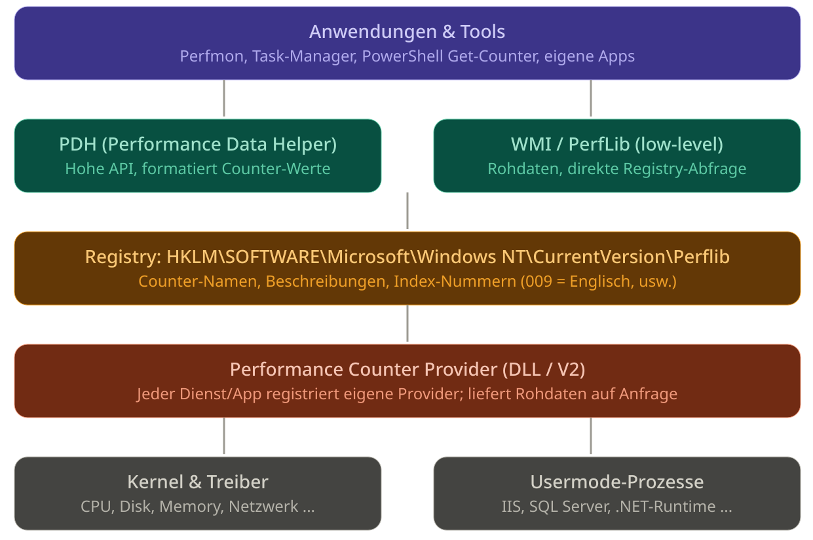
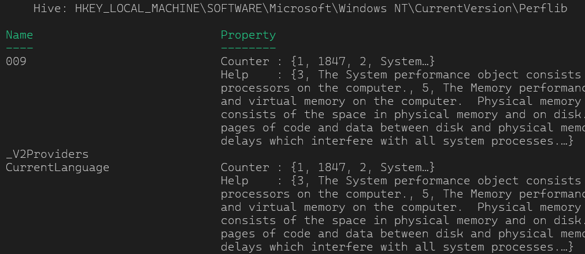
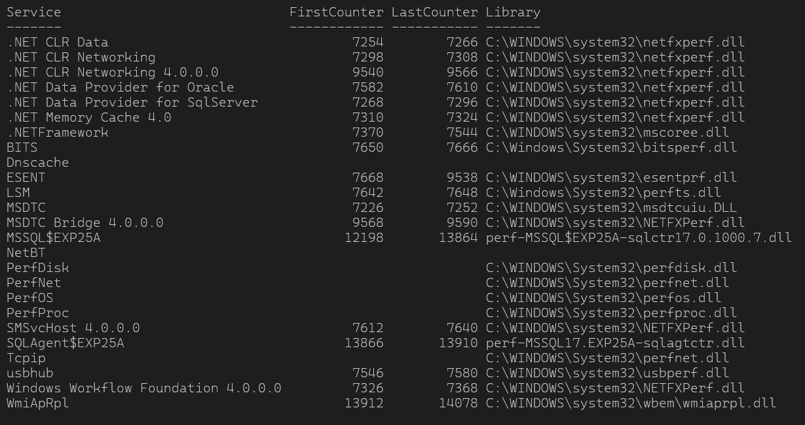
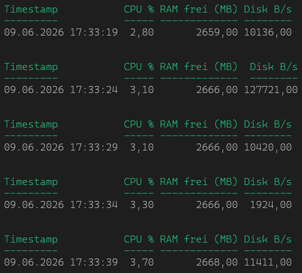

# Intro

[psTerminalPerfCounter](https://github.com/gabrielkoehl/psTerminalPerfCounter "github.com/gabrielkoehl/psTerminalPerfCounter")

Knapp ein Jahr ist es nun her, dass ich mit der Entwicklung von psTerminalPerfCounter begann. Stolz auf die „grafische“ Implementierung, Sprachunabhängigkeit mittels 3rd-Party-Lib und den damaligen heiligen Gral: Klassen in PowerShell.

Nichts davon ist geblieben:

- Grafische Implementierung? Schön bunt aber…
  - Bei Multiserver Umgebungen träge wie ein Stein
  - Dynamisch und Skalierbar, Fehlanzeige
  - Neuimplementierung in TUI (BETA)
- Multilanguage per 3rd Party Lib
  - Geht alles direkt per Windows Registry, durch Zufall darüber gestolpert
- Klassen in PowerShell? Sehr schlechte Entscheidung.
  - Nicht praktikabel, Instanzen nicht ohne weiteres serialisierbar, Methoden gehen verloren, Parallel Remoting mit Runspaces kaum umsetzbar
  - Rebuild in C#

Mit dem aktuellen Release 0.4.1 sind erst mal alle Funktionen implementiert, welche ich im Backlog hatte. Da mir die nächsten Monate dazu die Zeit für dieses Projekt fehlen wird, ist dies ein guter Moment ein [HandsOn](../psterminalperfcounter-counter-in-terminal-handson/index.de.md) zu schreiben, da die README.md im Repo doch manchmal herausfordernd ist… wie es scheint 🙂 Bevor es zum [HandsOn](../psterminalperfcounter-counter-in-terminal-handson/index.de.md) geht, aber erst mal ein wenig zur Technik und Geschichte der Performance Counter.

# Geschichte

Windows Performance Counter gibt es in Windows seit **NT 3.1 (1993)**, da hatte ich noch nicht mal einen Computer. Microsoft brauchte damals eine standardisierte Methode, um Systemzustände anzeigbar zu machen, ohne dass jede Anwendung eigene Monitoring-Mechanismen implementieren musste. Das hieẞ aber auch Messwerte aus der Registry kratzen und Deltas berechnen.

Mit **Windows 2000** kam der *Performance Data Helper* (PDH) als komfortable High-Level-API dazu, die den Zugriff auf Performance Counter so gestaltet, wie wir ihn heute kennen. Gleichzeitig wurde WMI eingeführt, das Performance-Daten über eine objektorientierte Schnittstelle zugänglich machte. CIM war ja nicht proprietär und zu kompatibel 😛

**Windows Vista** brachte das überarbeitete **Provider V2-Modell**: Statt einer DLL, die vom System in einen fremden Prozess geladen wurde (fehleranfällig, Absturz des Providers = Absturz des abfragenden Prozesses), registrieren sich Provider seitdem als eigenständige ausführbare Dateien oder Dienste. Das ist das heute noch gültige Modell.

# Aufbau und Funktion



## Metadaten in der Registry

Alle bekannten Counter sind unter `HKLM\SOFTWARE\Microsoft\Windows NT\CurrentVersion\Perflib` registriert. Dort liegen Name, Beschreibung und eine numerische Index-Nummer pro Counter, getrennt nach Sprache (Unterkey `009` für Englisch, `007` für Deutsch usw.).

```powershell
# List available language packs (counter IDs)
Get-ChildItem "HKLM:\SOFTWARE\Microsoft\Windows NT\CurrentVersion\Perflib"
```



## Provider liefern die Rohdaten

Jede Komponente (Kernel, Treiber, Dienste wie IIS oder SQL Server, die .NET-Runtime) kann eigene Counter registrieren. Der Provider wartet passiv und liefert Daten erst dann, wenn sie jemand abfragt. Es gibt keinen dauerhaften Sammeldienst im Hintergrund.

```powershell
# List all services that have a Performance subkey

Get-ChildItem "HKLM:\SYSTEM\CurrentControlSet\Services" |
    Where-Object { Test-Path "$($_.PSPath)\Performance" } |
    ForEach-Object {
        $perf = Get-ItemProperty "$($_.PSPath)\Performance"
        [PSCustomObject]@{
            Service      = $_.PSChildName
            FirstCounter = $perf.'First Counter'
            LastCounter  = $perf.'Last Counter'
            Library      = $perf.Library
        }
    } | Format-Table -AutoSize
```



## APIs für Anwendungen (CONSUMER)

- **PDH** (Performance Data Helper): Die bequeme API, die Werte bereits formatiert (z. B. Prozentwerte berechnet, Intervalle berücksichtigt). `Get-Counter` in PowerShell nutzt PDH.
- **PerfLib / Registry direkt**: Schneller, aber roh. WMI nutzt diesen Weg intern.

**Aufbau**

\\Prozessor(\_Total)\\Prozessorzeit (%)  
 └─ Objekt: „Prozessor“  
 └─ Instanz: „\_Total“ (Summe aller Kerne)  
 └─ Counter: „Prozessorzeit (%)“

# Microsofts Tools

## Der Großvater PerfMon

Der Performance Monitor ist seit NT-Zeiten das offizielle Werkzeug von Microsoft und für das, wofür er gebaut wurde, nach wie vor ausgezeichnet: interaktive, grafische Tiefenanalyse einzelner Systeme, mit Aufzeichnung über Data Collector Sets, CSV-Export via `relog` und grundlegendem Remoting. Die Grenzen zeigen sich, sobald man skalieren, automatisieren oder schlicht im Terminal arbeiten will. Portable Konfigurationsdateien, mehrere Server gleichzeitig im Blick oder ein strukturierter Konsolenworkflow sind nicht seine Stärken.

## Der NewComer Windows Admin Center

Microsofts browserbasierte Verwaltungsoberfläche bringt ebenfalls eine Performance-Ansicht mit, übersichtlicher als Perfmon und ohne lokale Installation auf dem verwalteten System. Für einen schnellen Blick auf CPU, Speicher und Netzwerk reicht das völlig aus. Zwei Punkte schränken den praktischen Nutzen jedoch ein: Erstens setzt WAC eine zentrale Installation voraus, mal eben auf einem Client oder beim Kunden starten geht nicht. Zweitens basiert die Counter-Auswahl wie überall auf der lokalisierten PDH-API, was Workspaces nicht wirklich transportabel macht.

## Das Evergreen – Get-Counter

`Get-Counter` ist das PowerShell-Äquivalent für den Konsolenbetrieb und damit das flexibelste der drei Werkzeuge, solange man ~~frickeln möchte~~ bereit ist, selbst Hand anzulegen. Counter lassen sich direkt abfragen, per Schleife wiederholen und in die Pipeline schicken. Remoting funktioniert über den `-ComputerName`-Parameter. Das Problem ist dasselbe wie überall: Die Counter-Pfade sind sprachabhängig, ein auf einem deutschen System geschriebenes Skript schlägt auf einem englischen fehl. Hinzu kommt, dass `Get-Counter` Rohdaten liefert. Formatierung, Schwellenwerte, Verlaufsdarstellung und strukturierte Ausgabe sind vollständig Handarbeit. Für Einmalabfragen und schnelle Checks ist es ideal, für reproduzierbare, mehrsprachige Umgebungen stößt es schnell an seine Grenzen.

```powershell
# Query CPU, memory and disk counters every 5 seconds, format output as table
$counters = @(
    '\Processor(_Total)\% Processor Time',
    '\Memory\Available MBytes',
    '\PhysicalDisk(_Total)\Disk Bytes/sec'
)

# German Counternames
# $counters = @(
#	'\Processor(_Total)\% Processor Time',
#	'\Memory\Available MBytes',
#	'\PhysicalDisk(_Total)\Disk Bytes/sec'
# )

Get-Counter -Counter $counters -SampleInterval 5 -Continuous | ForEach-Object {
    $sample = $_.CounterSamples

    [PSCustomObject]@{
        Timestamp       = $_.Timestamp
        'CPU %'         = [math]::Round(($sample | Where-Object Path -like '*processor*').CookedValue, 1)
        'RAM frei (MB)' = [math]::Round(($sample | Where-Object Path -like '*available*').CookedValue, 0)
        'Disk B/s'      = [math]::Round(($sample | Where-Object Path -like '*disk bytes*').CookedValue, 0)
    } | Format-Table -AutoSize
}
```



# Der Weg in die Sprachunabhängigkeit

Wie ihr seht, ist die Sprachabhängigkeit bei allen Implementierungen ein großes Problem. Dabei ist das gar nicht nötig. Unter der Haube hat jedes Counterobjekt und jeder Counter eine eindeutige ID. Schaut mal oben in den Screenshots, da steht immer First und Last Counter. Somit wird aus `\Processor(_Total)\Processor Time (%)` –> `\238(_Total)\6` .

```powershell
# Read counter ID/name mapping from registry (English - key 009, German - key 007)
Get-ItemProperty -Path 'HKLM:\SOFTWARE\Microsoft\Windows NT\CurrentVersion\Perflib\009' -Name Counter |
		Select-Object -ExpandProperty Counter | Select-Object -First 20
```


That’s it. Nun müssen einmal das Counter-Objekt und der Pfad übersetzt werden und schon habe ich meinen sprachunabhängigen CounterPfad. Vor dem Ausführen wird er auf dem Zielsystem übersetzt und dann `Get-Counter -Counter <TRANSLATION>` ausgeführt. Das übernimmt in psTerminalPerfcounter das CMDLET [**get-tpcPerformanceCounterInfo**](https://github.com/gabrielkoehl/psTerminalPerfCounter/blob/main/src/psTerminalPerfCounter/psTerminalPerfCounter/Public/Get-tpcPerformanceCounterInfo.ps1)

[psTerminalPerfCounter – Performance Counter im Terminal – HowTo](../psterminalperfcounter-counter-in-terminal-handson/index.de.md "Hands-on zu psTerminalPerfCounter: Windows Performance Counter im Terminal überwachen, inklusive TUI, Multiserver-Monitoring sowie CSV- und HTML-Export.")


